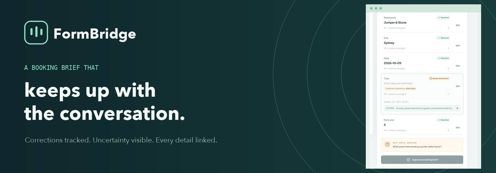
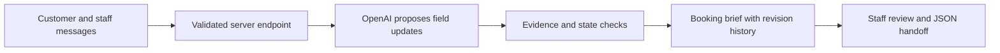

<div align="center">
  

  <p><strong>Turn a changing restaurant enquiry into a brief a person can check, approve, and hand off.</strong></p>

  <p>
    <a href="https://formbridge-nlp-at2.vercel.app/">Open the live demo</a>
    ·
    <a href="#watch-formbridge">Watch the films</a>
    ·
    <a href="#run-locally">Run locally</a>
  </p>
</div>

---

A customer says “four people at seven”, then changes it to “five, sometime after eight”. A typical form can keep the wrong time or quietly guess a new one. **FormBridge records the correction, keeps the exact time open, and shows the message behind each detail.** Staff can review the brief before approving it for handoff.

**Approval does not place a reservation.** This is a coursework demo for restaurant enquiries using synthetic conversations.

## Watch FormBridge

### FormBridge in under a minute

Watch a changing booking enquiry become an evidence-linked, human-reviewed brief.

https://github.com/user-attachments/assets/18bf88d7-7031-447f-bc3c-800a070171ed

### A two-minute product walkthrough

Follow one synthetic enquiry through extraction, correction, clarification, acceptance, and staff approval.

https://github.com/user-attachments/assets/3d43b8a2-d011-4e47-aeac-9c11354216b4

The films use edited captures from the [live app](https://formbridge-nlp-at2.vercel.app/) with a synthetic booking conversation. The narration is generated with OpenAI text to speech. The [scene script and transcript](docs/media/film-scenes.json) document what is shown and said. The [launch MP4](docs/media/FormBridge-launch.mp4) and [walkthrough MP4](docs/media/FormBridge-walkthrough.mp4) are also kept in the repository. The films illustrate one use case; they do not present evaluation results.

## The booking journey

1. **Start with the conversation.** Enter customer and staff messages in the left panel.
2. **Build a traceable brief.** Restaurant, city, date, exact time, and party size appear on the right with links to their source messages.
3. **Handle a change.** A correction supersedes the old value. A preference such as “after 8 pm” remains a constraint until an exact time is confirmed.
4. **Keep proposals distinct.** Staff can offer 8:30 pm, but the brief waits for the customer to accept it.
5. **Review and hand off.** Inspect evidence and change history, make a marked staff edit when needed, approve the brief, and download its JSON.

Try the prepared example in the app, or start a new brief with synthetic messages. The current draft lives in the browser tab's session storage. There are no accounts, database, payment flow, availability search, or booking integration.

## How it works



The web app is built with **Next.js 16 and TypeScript** and deployed on **Vercel**. The contextual extractor calls the **OpenAI Responses API** from the server with a structured output schema. Application code owns the booking state: it checks proposed updates, message references, corrections, constraints, and staff-reviewed values before applying them. The API key stays server-side.

The repository also contains a rule-based baseline and a direct contextual baseline. They are used for internal comparison against the guarded FormBridge pipeline. These approaches share the same five-field task, but the live booking desk uses FormBridge's guarded state flow.

| Area | Source |
| --- | --- |
| Booking desk and browser session | [`app/page.tsx`](app/page.tsx) |
| Analysis endpoint | [`app/api/analyze/route.ts`](app/api/analyze/route.ts) |
| OpenAI extraction | [`lib/ai.ts`](lib/ai.ts) |
| State, evidence, edits, approval | [`lib/state.ts`](lib/state.ts) |
| Rules and comparison modes | [`lib/rules.ts`](lib/rules.ts), [`lib/engine.ts`](lib/engine.ts) |
| Internal scenarios and evaluation | [`evaluation/`](evaluation/), [`scripts/`](scripts/) |

## Run locally

**Requirements:** Node.js 24 and pnpm 11.24.0.

```bash
pnpm install --frozen-lockfile
cp .env.example .env.local
pnpm dev
```

Add `OPENAI_API_KEY` to `.env.local` to analyse new customer messages, then open [http://localhost:3000](http://localhost:3000). The prepared example is a saved synthetic state and can be explored without an API key. `.env.local` is ignored by Git.

The default extraction model is pinned in [`.env.example`](.env.example). If you change `OPENAI_MODEL`, treat subsequent evaluation as a new configuration rather than mixing predictions across model versions.

```bash
pnpm test
pnpm typecheck
pnpm build
```

The private project evidence includes team-authored scenario runs and a bounded comparison using the [Schema-Guided Dialogue dataset](https://github.com/google-research-datasets/dstc8-schema-guided-dialogue). The source dataset is not committed. Use the scripts in [`scripts/`](scripts/) to audit eligible restaurant dialogues and reproduce a chosen sample; saved predictions and configurations live in [`evaluation/results/`](evaluation/results/). Those results are internal project evidence, not claims about real restaurant traffic or an official full-dataset leaderboard.

## Boundaries and data handling

- **Human review is required.** A message ID can be structurally valid without semantically proving a value. Staff should inspect linked evidence.
- **No booking is made.** Approval means the five-field brief is ready for handoff; the app does not contact a restaurant or check availability.
- **Uncertain dates and times stay visible.** Relative weekdays without a clear calendar date and non-exact time preferences trigger clarification.
- **The demo is for synthetic data.** Do not enter real customer details. The draft is held in browser session storage; the app has no database.
- **API access has limits.** The deployed endpoint validates request shape and size, and the Vercel project has an IP-based firewall rate limit. An IP limit cannot cap aggregate traffic from many IPs, so account usage still needs monitoring.
- **Provider processing still applies.** The server sends `store: false` with OpenAI Responses requests, which avoids storing a Responses object; it does not imply zero provider processing or retention.

## Project context

FormBridge was developed for the UTS NLP AT2 group project. The poster and group report are separate deliverables. Dataset attribution: [Google Research's Schema-Guided Dialogue dataset](https://github.com/google-research-datasets/dstc8-schema-guided-dialogue). The filmed restaurant and messages are synthetic.

---

<div align="center">
  <strong>FormBridge</strong><br />
  Clear state. Visible evidence. Human control.
</div>
