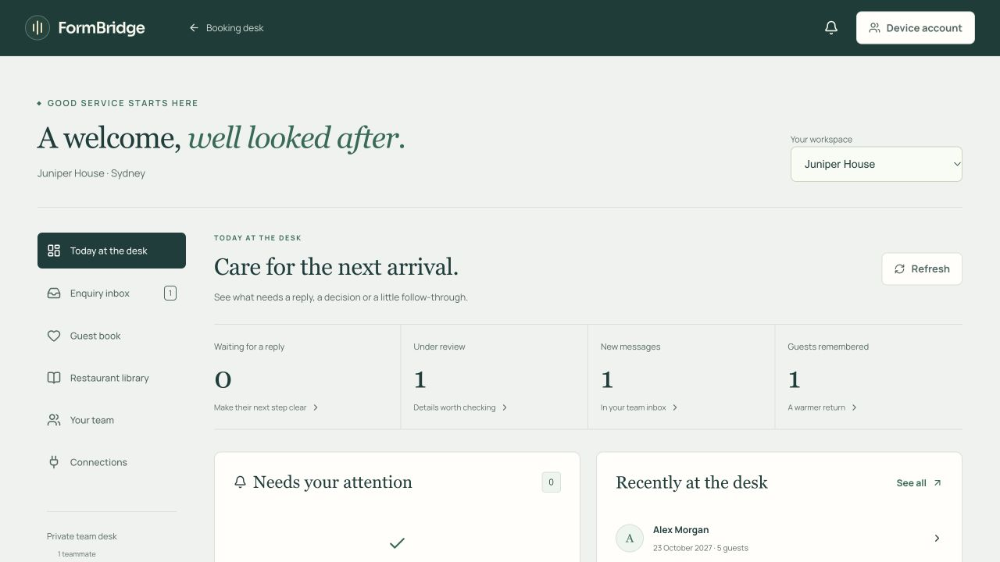
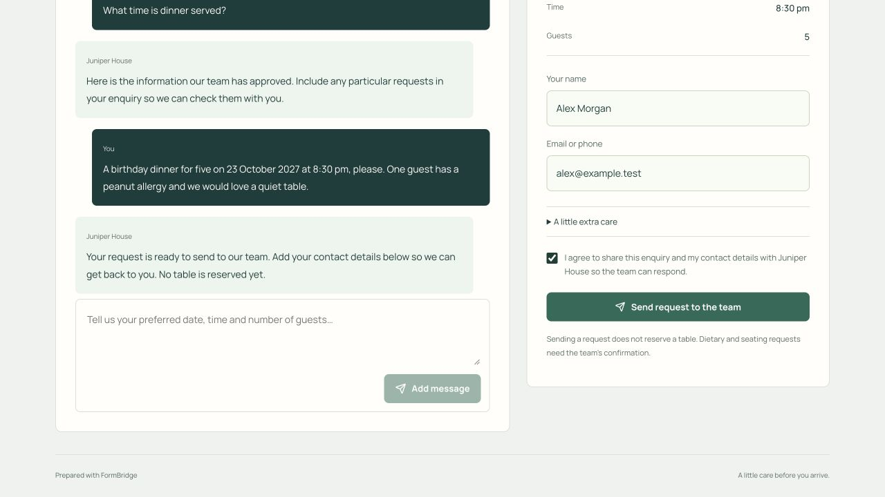
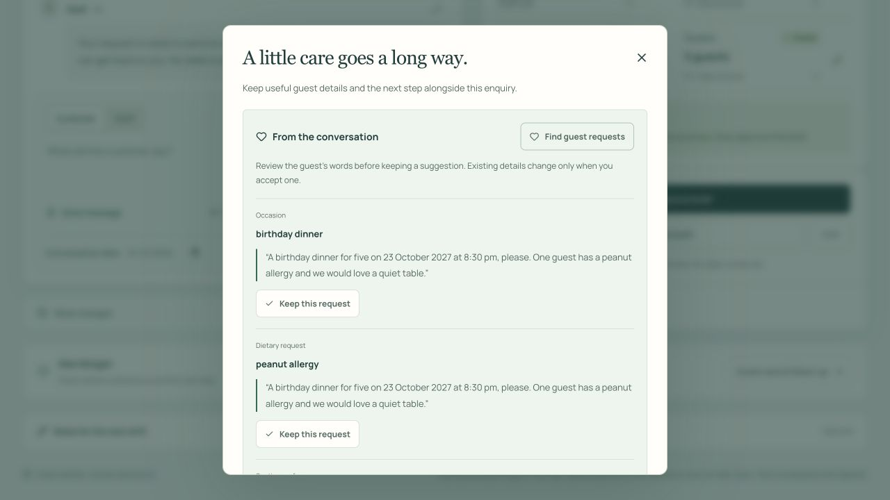
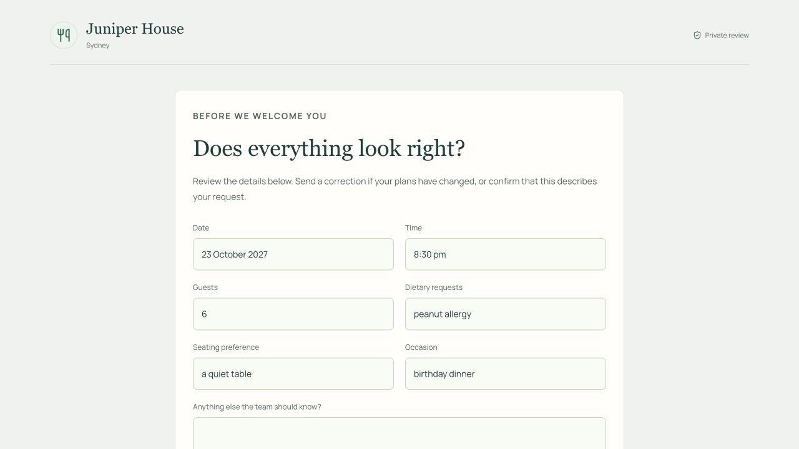
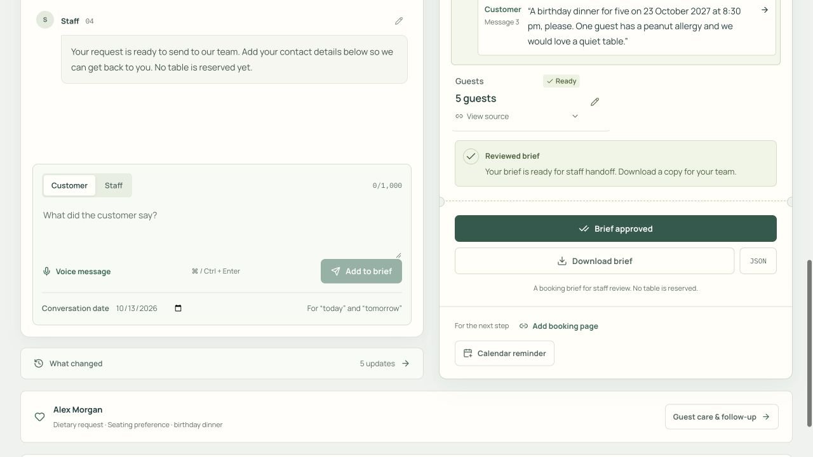
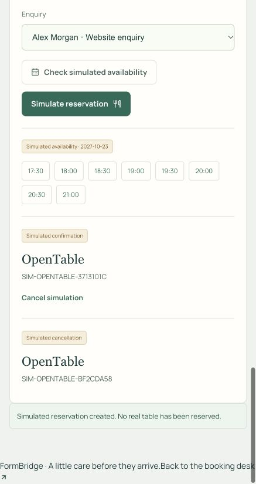

<div align="center">
  
  <p><strong>The restaurant enquiry desk, from the first hello to the next shift.</strong></p>
  <p>
    <a href="https://formbridge-nlp-at2.vercel.app/">Open FormBridge</a>
    · <a href="https://formbridge-nlp-at2.vercel.app/demo">Take the guided demo</a>
    · <a href="#see-it-in-action">Watch the films</a>
    · <a href="#make-it-your-restaurants-desk">Get started</a>
    · <a href="#run-locally">Run locally</a>
  </p>
</div>

---

A birthday dinner. One more guest. A later arrival. A quiet table worth remembering.

FormBridge brings restaurant enquiries into a shared desk. Guests can ask questions and send a request through your restaurant’s own assistant. Staff can check the conversation, prepare a booking brief, look after special requests and leave the next shift a clear next step.

**Bring your own conversations.** Type, paste or use a voice message. Start with an empty desk, or try an example to get a feel for it.

## Take the guided demo

[Follow a birthday enquiry from first hello to handoff](https://formbridge-nlp-at2.vercel.app/demo). Suggested messages appear on screen; press **Tab** to fill them, then send. Eight short chapters cover a guest enquiry, changed plans, source checks, guest care, staff approval, guest review and a simulated reservation handoff. Progress is kept in the tab, in a separate demo workspace.

## See it in action

### Meet FormBridge

A birthday enquiry, changed plans and a thoughtful handoff. **52 seconds.**

https://github.com/user-attachments/assets/65fff498-b276-4919-a373-08c716141f41

### The guided birthday enquiry, step by step

Follow all eight chapters of the live guided demo: the guest’s enquiry, changed plans, a staff reply, an accepted time, guest care, approval, private guest review and a simulated handoff. Tab suggestions and clear Guest/Staff turns show what to do next. **2 minutes 31 seconds.**

https://github.com/user-attachments/assets/c02a53df-f58d-401b-abb2-928663336aa9

[Launch film](docs/media/FormBridge-launch.mp4) · [Product walkthrough](docs/media/FormBridge-walkthrough.mp4) · [Launch captions](docs/media/FormBridge-launch.vtt) · [Walkthrough captions](docs/media/FormBridge-walkthrough.vtt)

## One desk for the whole enquiry



| For the guest | For the team |
| --- | --- |
| A restaurant assistant that answers from approved information | A library for opening hours, menus, accessibility, group dining and policies |
| A clear request with date, time and guest count | A booking brief with message sources, corrections and review controls |
| Space for dietary requests, seating preferences and occasions | Suggested guest-care details with supporting quotations and a choice to keep each one |
| A private link to check details and return a correction | An enquiry that reopens for review when the guest’s plans change |
| A conversation that can be resumed in the same tab | Owners, priorities, exact reminders and comments for the next shift |

### A welcome on your website

Publish a branded guest page or add the booking assistant to your website. It answers from the information your team has approved, gathers booking requests and asks for contact details before sending them to the desk. Unfinished requests are kept in the guest’s tab for up to 24 hours.



### Details you can check

The brief tracks **restaurant, city, date, time and guests**. Open a field to see its supporting messages. “After eight” stays a preference until an exact time is agreed. Staff can edit messages, correct speakers, review changes and approve the brief.

Guest-care suggestions show the words they came from. Keep the requests you have checked, then confirm dietary requirements with the guest and kitchen.



### A team that knows the next step

Move enquiries through **Needs reply**, **Under review** and **Handed off**. Assign a teammate, set a priority and due time, and add comments. Due reminders appear while the desk is open; overdue escalation also brings them to owners and managers.

Keep reviewed guest records with enquiry history. Link a case when you know it belongs to that guest, and confirm before combining duplicate records. Saved-edit checks help protect another teammate’s changes.

<details>
  <summary><strong>Guest review links</strong></summary>
  <p>Give the guest a private page with booking details and preferences. Links expire after 72 hours, can be revoked and become outdated after the saved enquiry changes. Staff notes, contact details and the transcript stay private.</p>
  
</details>

<details>
  <summary><strong>Voice, saved enquiries and shift planning</strong></summary>
  <p>Record or upload a short voice message and check its transcript before adding it. Search saved enquiries, prepare a reply with the desk assistant, download a brief or organise the next shift in the service planner.</p>
  
</details>

<details>
  <summary><strong>Channel and booking simulations</strong></summary>
  <p>Try email and WhatsApp threads with follow-ups, duplicate delivery and reviewed reply drafts. Test availability, handoff, cancellation and failure responses with mock OpenTable, SevenRooms, Resy and TheFork connectors.</p>
  <p><strong>These connections are simulations.</strong> They do not contact guests, check real inventory or make reservations.</p>
  <p align="center"></p>
</details>

## Make it your restaurant’s desk

1. [Open FormBridge](https://formbridge-nlp-at2.vercel.app/) and add your first enquiry. The booking desk and device library work without an account.
2. Open **Team workspace** and choose **Continue on this device**. Create a private team or join one with its invitation code.
3. In **Restaurant library**, add your restaurant and approve the information guests may see. Publish the guest assistant and copy its link or website embed.
4. Pick up requests in **Enquiry inbox**. Check the brief and guest-care suggestions, then approve and save the enquiry.
5. Assign the next step, share a private guest review link, or prepare the shift handoff.

**Approving a brief does not reserve a table.** FormBridge helps the team review requests and prepare the handoff. Real reservations still need to be made through the restaurant’s booking process.

## Run locally

Use Node.js 24 and pnpm 11.24.0.

```bash
pnpm install --frozen-lockfile
cp .env.example .env.local
```

Add your `OPENAI_API_KEY` to `.env.local`, then:

```bash
pnpm dev
```

Open [localhost:3000](http://localhost:3000). Without an API key, the prepared example, manual review and device library remain available. Keep `.env.local` private; Git excludes it.

For teams, apply `supabase/migrations/` in filename order and configure the Supabase variables in `.env.example`. Enable anonymous sign-ins and set `NEXT_PUBLIC_DEVICE_SIGN_IN_ENABLED=true` for device accounts. The Supabase secret and OpenAI key stay on the server.

Verified email registration and recovery require a working SMTP sender, the correct authentication redirect URL and `NEXT_PUBLIC_EMAIL_DELIVERY_ENABLED=true`. The hosted app offers device sign-in. You can also [try email access](https://formbridge-nlp-at2.vercel.app/auth/preview) with a sample inbox: create a sample account, verify it, sign in and reset its password. This clearly labelled simulation stays on the page, clears on reload and never sends email or changes real accounts. Live email registration stays off until delivery is configured and tested.

On Vercel, configure the environment variables before building. Production uses Supabase for a shared allowance across analysis, guest intake, assistant and voice requests. Manual review and saved cases remain available when the AI allowance is reached. See the [operations guide](docs/OPERATIONS.md) for deployment and maintenance.

```bash
pnpm test
pnpm typecheck
pnpm build
```

**Built with Next.js, TypeScript, OpenAI, Supabase and Vercel.**

## Your data

- The active booking draft stays in its browser tab. **This device** cases stay in that browser; **team** cases are stored in Supabase and available to team members.
- Device accounts cannot be recovered after browser data is cleared. Keep a private team invitation or download important enquiries.
- Guests choose whether to share their request and contact details with the restaurant. The published assistant exposes approved restaurant information; private review links expose only the details needed for that review.
- Conversation and assistant requests are processed by OpenAI. Voice transcription sends the selected audio to OpenAI; FormBridge does not retain the raw audio. Check the transcript and booking details before using them.

---

<div align="center">
  <strong>FormBridge</strong><br />
  Clear details. Thoughtful service.
</div>
