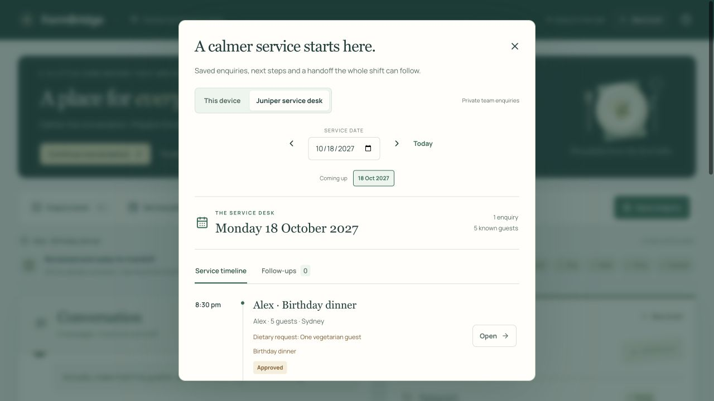
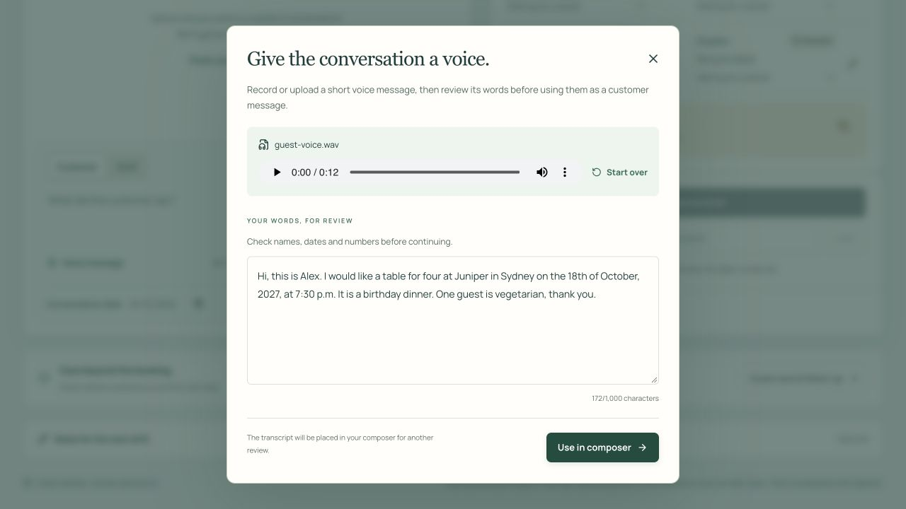
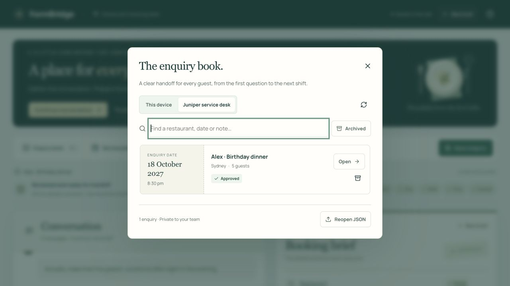
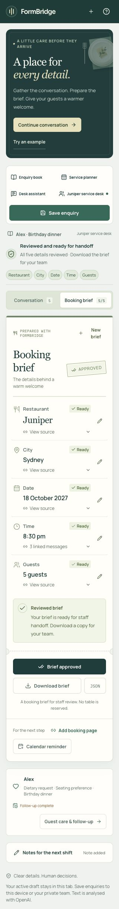

<div align="center">
  

  <p><strong>Your restaurant enquiry desk, from the first message to the next shift.</strong></p>

  <p>
    <a href="https://formbridge-nlp-at2.vercel.app/">Open FormBridge</a>
    ·
    <a href="#see-it-in-action">Watch the films</a>
    ·
    <a href="#run-locally">Run locally</a>
  </p>
</div>

---

A birthday dinner. One more guest. A later arrival. FormBridge turns the conversation into a clear booking brief, keeps guest requests close, and helps your team follow through.

Bring your own enquiry by typing, pasting or using a voice message. Check the sources behind each detail, save the case, and leave the next shift a useful handoff.

## See it in action

### Meet FormBridge

From a voice enquiry to a thoughtful handoff. **1 minute.**

https://github.com/user-attachments/assets/2e3bc586-31e8-486b-bbb0-ab09d1b3d639

### A birthday dinner, from first hello to handoff

Follow a change of plans, check the agreed time, prepare a follow-up and save the enquiry to a private team desk. **2 minutes 53 seconds.**

https://github.com/user-attachments/assets/23a82dc9-b820-46a5-b418-846f9378b808

[Launch film](docs/media/FormBridge-launch.mp4) · [Product walkthrough](docs/media/FormBridge-walkthrough.mp4) · [Launch captions](docs/media/FormBridge-launch.vtt) · [Walkthrough captions](docs/media/FormBridge-walkthrough.vtt)

## Made for the way enquiries happen

| At the desk | With FormBridge |
| --- | --- |
| A conversation arrives in pieces | Type customer and staff messages, paste a transcript, or record or upload a short voice message. |
| The guest changes their plans | The brief follows corrections. Preferences and alternatives stay open until an exact answer is agreed. |
| A detail needs checking | Select it to see the supporting messages and previous values. Edit the conversation or review a conflicting change. |
| A guest needs a little extra care | Keep a name, contact details, dietary requests, seating preference and occasion beside the enquiry. |
| The next step needs attention | Ask the desk assistant for a reply, a follow-up or a shift note. Review its proposal before applying it. |
| Another shift takes over | Reopen saved cases, see upcoming enquiries, complete follow-ups and download a shift handoff. |
| The team works together | Create a private workspace from this device and invite teammates with a code. Conflicting saved edits are checked before replacement. |

**The brief tracks restaurant, city, date, time and guests.** Guest-care details and staff tasks stay alongside it. “After eight” remains a time preference; an accepted suggestion of 8:30 pm can become the agreed time, with the relevant messages linked.

**Approving a brief does not reserve a table.** FormBridge prepares information for staff review. Venue booking pages and tentative calendar reminders help with the next step; availability and reservations are handled by the restaurant or booking provider.

## A place for every detail


<details>
  <summary>The service planner</summary>
  <p>Saved enquiries in time order, with guest requests and a handoff for the shift.</p>
  
</details>

<details>
  <summary>Voice input</summary>
  <p>Review the transcript before it becomes part of the conversation.</p>
  
</details>

<details>
  <summary>The enquiry book</summary>
  <p>Search, reopen or archive cases saved to your device or private team.</p>
  
</details>

<details>
  <summary>On mobile</summary>
  <p align="center"></p>
</details>

## Bring your own enquiry

1. [Open FormBridge](https://formbridge-nlp-at2.vercel.app/). A new visit starts with an empty brief.
2. Add a customer message, paste a conversation, or open **Voice message**. Review a voice transcript before using it in the composer.
3. Add staff replies and further customer messages. Check the brief and ask for any missing details.
4. Add guest requests, prepare a follow-up with the assistant, and save the enquiry to **This device** or your private team.
5. Approve the reviewed brief, download a copy, or open **Service planner** to prepare the next shift.

The booking desk and device library work without an account. In **Team workspace**, choose **Continue on this device** to create or join a private team. Keep the team's invitation code if you need to join from another browser. **Try an example** is available when you want a quick introduction.

## Run locally

Use Node.js 24 and pnpm 11.24.0.

```bash
pnpm install --frozen-lockfile
cp .env.example .env.local
```

Add your `OPENAI_API_KEY` to `.env.local`, then start the app:

```bash
pnpm dev
```

Open [localhost:3000](http://localhost:3000). Without an API key, the prepared example, manual review and device library remain available. Keep `.env.local` private; Git excludes it.

For private teams, create a Supabase project, apply `supabase/migrations/` in filename order, and fill in the three Supabase variables in `.env.example`. Enable anonymous sign-ins in Supabase Auth and set `NEXT_PUBLIC_DEVICE_SIGN_IN_ENABLED=true` to offer device sign-in. The publishable key is used by the browser; the secret key stays on the server.

For Vercel, configure the same environment variables before building. Supabase is required in production for the shared allowance covering analysis, assistant and voice requests. When that allowance is reached, manual review and saved cases remain available. Configuration and maintenance are covered in the [operations guide](docs/OPERATIONS.md).

```bash
pnpm test
pnpm typecheck
pnpm build
```

**Built with Next.js, TypeScript, OpenAI, Supabase and Vercel.** The server keeps the OpenAI key private, and the application checks proposed booking changes before updating the brief.

## Your data

The active draft stays in this browser tab. **This device** cases stay in this browser; **team** cases are stored in Supabase and visible to team members. Device sign-in has no account recovery after browser data is cleared, so keep a team invitation code or download a copy of important enquiries.

Conversation and assistant requests are sent to OpenAI for processing. Voice transcription sends the selected audio to OpenAI; FormBridge does not save the raw audio. Check the transcript and brief before using them, and enter only the information needed for the enquiry.

---

<div align="center">
  <strong>FormBridge</strong><br />
  Clear details. Thoughtful handoff.
</div>
