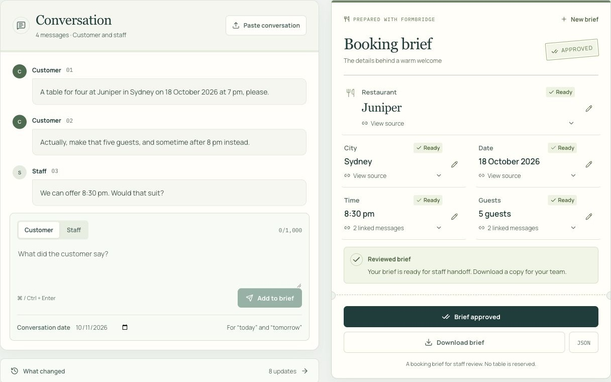
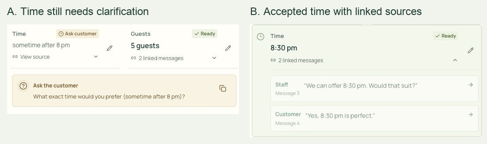

<!-- PAGE 1 -->
# FormBridge
## Evidence-linked dialogue state tracking for restaurant booking briefs

**36118 Applied Natural Language Processing · Spring 2026**

**Assessment Task 2, Part B · Group technical report**

A restaurant booking desk that keeps the conversation, the current request and the human review together.

**Group members:** [Add each member's full name and student ID]

**Individual submitting student:** [Add name and student ID]

**Report date:** 11 October 2026

**Application:** https://formbridge-nlp-at2.vercel.app/

**Source repository:** https://github.com/KarthikRamesh9149/NLP-AT2

**Project scope:** English-language restaurant enquiries; five booking fields; staff-reviewed text and JSON handoff.

**Evidence version:** Application release 0b6bc90; evaluated extraction and runner frozen at 32af459. Later evidence and media commits do not change the evaluated source.

<!-- PAGE 2 -->
# Abstract and report guide

A restaurant enquiry rarely arrives as a finished form. A customer may change the number of guests, offer a time range or accept a staff suggestion several messages later. FormBridge turns this conversation into an editable booking brief while keeping unresolved details visible. The web application tracks restaurant, city, date, time and party size, links model-derived details to their source messages, records revisions and requires staff approval before handoff.

The project compares a rule-based extractor, direct contextual extraction and FormBridge's contextual extraction with evidence checks and state reconciliation. Evaluation uses a documented restaurant subset of Google's Schema-Guided Dialogue dataset. The final production configuration achieved 100/100 field checks on an inspected 20-dialogue regression sample and 96/100 on a repeatedly used 20-dialogue development selection. In a separate same-model comparison, direct extraction and FormBridge both achieved 92/100 canonical field checks on development data and 62/65 on 13 previously unselected test dialogues. FormBridge produced more consistent representations under the stricter matcher, but also used more tokens and longer replay times.

The application demonstrates a practical review workflow rather than autonomous reservation execution. Recorded browser checks cover 20 ordinary enquiries and 15 edge cases; native text and JSON downloads were verified. No recruited-user study was conducted. The evidence supports a functioning, reviewable NLP application within a narrow domain, with clear limits on generalisation and measured user benefit.

## Contents

| Section | Page |
| --- | --- |
| 1. Problem, objectives and scope | 3 |
| 2. Application features and user journey | 4 |
| 3. System architecture and state design | 5 |
| 4. NLP methods and technical choices | 6–7 |
| 5. Data sources and preparation | 8 |
| 6. Evaluation design and reproducibility | 9 |
| 7. Results | 10 |
| 8. Findings, errors and challenges | 11 |
| 9. Interaction design and verification | 12 |
| 10. Ethics, limitations and next steps | 13 |
| 11. Project phases, contributions and conclusion | 14 |
| References | 15 |
| Appendices A–C: reproduction, evidence and acknowledgement | 16–18 |

<!-- PAGE 3 -->
# 1. Problem, objectives and scope

## 1.1 The problem and intended users

Consider a customer who asks for four people at seven, then changes the request to five people sometime after eight. Copying the first message into a form gives the wrong brief. Copying the final message alone loses the restaurant, date and city. Choosing 8:30 pm would invent a decision the customer has not made. The task therefore needs both an understanding of language and a record of how the request develops.

FormBridge is intended for small restaurant service teams, particularly staff preparing or handing over enquiries. Its design assumption is that the conversation and the booking details should be reviewed together. This is a proposed workflow need, supported by realistic enquiry scenarios; the project did not conduct interviews or establish demand through restaurant adoption.

The application addresses dialogue state tracking: maintaining the current set of requested slot values as a conversation progresses. Earlier work such as TRADE models this as generating a dialogue state from utterances, including values outside a fixed ontology (Wu et al., 2019). The Schema-Guided Dialogue dataset provides a relevant task-oriented corpus with service schemas and state annotations (Rastogi et al., 2020). FormBridge builds on this problem formulation and public data, using hosted contextual extraction rather than retraining those research models.

## 1.2 Objectives and research question

The primary objective was to produce a usable web application that gathers five booking details, responds to revisions and makes the resulting brief easy to inspect. The technical objectives were to compare traditional and contextual extraction, implement explicit evidence and temporal checks, and preserve enough configuration and output information for another person to reproduce the experiment.

**Research question:** How does contextual extraction with evidence checking and state reconciliation compare with rules and direct contextual extraction when maintaining restaurant booking information, and what does that additional structure contribute to staff review?

The question separates value accuracy from interaction quality. A field can match a dataset label while still needing clarification before staff can approve it. Likewise, a visually complete form can be inaccurate. The system therefore measures automatic value agreement separately from the user-facing review workflow.

## 1.3 Scope and success conditions

| Included | Boundary |
| --- | --- |
| Restaurant, city, date, time and guest count | One restaurant reservation enquiry per brief |
| Pasted transcripts and incremental messages | English-language text; up to 30 messages |
| Corrections, uncertainty, source links and history | Exact details stay unresolved when evidence is insufficient |
| Manual review, approval and downloads | Approval prepares information for staff |
| Public web application and local reproduction | No availability search, restaurant contact, payment or table reservation |

Success means that staff can enter their own enquiry, inspect the current values and their sources, resolve uncertainty and export a reviewed brief. The evaluation assesses those implemented behaviours and automatic extraction within the stated scope. It does not measure real restaurant outcomes, revenue or time saved during actual service.

<!-- PAGE 4 -->
# 2. Application features and user journey

The application starts with an empty workspace. Examples are available through an explicit button, while the main route supports the user's own conversation. A transcript can be pasted with Customer: and Staff: labels, or entered one message at a time. Unlabelled short text is treated as a customer enquiry. Speaker labels matter because a staff offer is not automatically the customer's choice.

*Figure 1. Current live application, captured on 11 October 2026 using an authored enquiry. The reviewed request is Juniper, Sydney, 18 October 2026, 8:30 pm and five guests. The screenshot illustrates behaviour; it is not a benchmark result.*

## 2.1 From enquiry to reviewed brief

1. **Gather:** Enter “A table for four at Juniper in Sydney on 18 October 2026 at 7 pm.”
2. **Revise:** Add “Actually, make that five guests, and sometime after 8 pm instead.” Five guests becomes the current value; the exact time remains open.
3. **Clarify:** The application suggests a question asking for the exact time. Staff can copy it and add the customer's reply.
4. **Check:** A staff offer of 8:30 pm becomes ready after the customer accepts. Selecting Time displays both source messages.
5. **Hand over:** Staff review or edit the details, approve the current revision and download text or JSON.

## 2.2 Features that support review

Each field shows a status: Needed, Ask customer, Ready or Reviewed. These combine text and icons, so colour is not the only signal. A source link opens the relevant messages; change history preserves earlier values. Manual edits are labelled as staff input and retained during subsequent analysis. If the conversation later conflicts with an edit, the interface asks staff to review that detail.

Approval requires five resolved, non-empty fields and no unfinished analysis. A semantic change clears prior approval. The approved state says that the brief is ready for handoff, while the interface explicitly states that no table has been reserved. Drafts survive refresh in the current browser tab, and New brief starts the next enquiry.

<!-- PAGE 5 -->
# 3. System architecture and state design

FormBridge uses Next.js 16.3.6, React 19.3.0 and TypeScript 5.9.3, with a Node.js server route on Vercel. OpenAI SDK 7.23.0 supplies contextual extraction, and Zod 4.6.5 defines request and output contracts. The dependency lockfile fixes the installed package versions for reproduction.

*Figure 2. Implemented flow. The model predicts a candidate state; deterministic application code checks evidence and reconciles the brief. A validation-directed repair is limited to one additional model request.*

## 3.1 Separation of responsibilities

The browser owns the transcript, current draft and review controls. POST /api/analyze validates the incoming request before calling the selected analysis method. In the live product, the interface selects FormBridge; rules and direct extraction are available in the technical evaluation runner rather than presented as extra staff-facing modes.

The model receives the ordered, visible conversation and an optional reference date. It returns a candidate for each of the five fields. Application code checks supporting quotations, admissible values, acceptance and recency before updating authoritative state. Clarification questions are generated from deterministic templates, making their relationship to the unresolved field inspectable.

This separation allows the interface, extraction provider and reconciliation code to be changed independently. It also gives tests a stable target: approval, cancellation, evidence checking and manual overrides can be checked without calling a paid model.

## 3.2 State and persistence

A field stores its value, status, constraint, evidence message IDs, source and explanatory note. A brief also stores revision history, its current revision and the revision that was approved. This distinguishes an unanswered field from a stated preference such as “after 8 pm”, and distinguishes an extracted detail from an intentional staff edit.

The draft uses browser session storage. There is no FormBridge account or customer database. This keeps the submission focused on one review session and limits application-side persistence, but excludes shared inboxes, durable case histories and cross-device collaboration. Downloads are explicit local exports. Provider processing and retention remain a separate concern, discussed in Section 10.

The server imposes request-size and schema limits. Its local production rate limiter allows up to 60 requests per minute per observed address within one process. Because serverless instances do not share this map, it is a basic protection rather than a durable global quota. A shared limiter would be necessary for broader operational use.

<!-- PAGE 6 -->
# 4. NLP methods and technical choices

## 4.1 Three approaches to the same task

| Method | Implementation | Reason for including it |
| --- | --- | --- |
| Rules | Regular expressions, number-word conversion, explicit correction patterns and simple acceptance of the preceding staff offer | An interpretable, model-free baseline for explicit booking language |
| Direct contextual extraction | A structured five-field prediction from the complete visible prefix | Tests the benefit of contextual language understanding without FormBridge's evidence reconciliation |
| FormBridge | Contextual candidates with quotations and message IDs, followed by deterministic checks, bounded repair and revision-aware reconciliation | Tests a more inspectable state flow suitable for staff review |

The rules recognise common party-size phrases, full calendar dates, explicit times, after-time constraints and named restaurants or cities in restricted patterns. They process messages in order and use a simple acceptance pattern to connect a customer reply with the preceding staff message. This is a substantive baseline, although its limited lexical patterns are unlikely to cover the variation in a public dialogue corpus. It uses no learned parameters or API tokens.

The direct baseline reconstructs the five-field state at every customer turn. Its structured output contains value, status and constraint, but no evidence citations. Its prompt also prohibits invented values and unaccepted staff offers. This provides a fairer control than comparing FormBridge with an unrestricted summarisation prompt.

FormBridge reconstructs candidates from the same visible prefix. Prior browser state supplies staff overrides and history; it is not itself proof that a predicted value is true. The current method is therefore best described as contextual state extraction with deterministic reconciliation, rather than a model that learns from the user's corrections.

## 4.2 Why a hosted LLM and structured output?

Contextual extraction was selected because acceptance, correction and omitted context extend beyond a small set of regular expressions. A hosted model allowed the project to spend effort on state integrity, review controls and comparison, without assembling a new training corpus or serving a fine-tuned model. This choice brings network dependency, variable latency, external data processing and limited control over model weights.

The Responses API parses a Zod-derived output schema. OpenAI distinguishes schema adherence from factual correctness: structured output can still contain mistakes (OpenAI, n.d.-b). FormBridge therefore validates what a candidate is supported by, in addition to whether it is shaped correctly.

The final production settings are GPT-6 Luna for primary extraction and at most one GPT-6.1 Sol repair, with low reasoning effort. The controlled comparison instead uses GPT-6 Luna for both AI approaches and for every repair. These names are recorded project configurations and provider-returned model identifiers. They are aliases rather than immutable research checkpoints, so future provider reruns may differ.

## 4.3 Avoiding unnecessary complexity

Retrieval-augmented generation was not implemented because the required evidence is the conversation itself; no external document corpus is needed. Fine-tuning, multilingual support and booking integrations remain future options. The project contribution is the implemented combination of contextual extraction, checked evidence, explicit uncertainty and human review, not a claim of a new foundational language model.

<!-- PAGE 7 -->
# 4. NLP methods and technical choices, continued

## 4.4 Evidence checking and state reconciliation

For each candidate, the system verifies that cited message IDs exist, quotations occur within those messages and at least one cited message comes from the customer. A value must be supported by a customer statement or by a staff statement with a later customer acceptance. Dates composed across messages receive additional checks. These mechanisms make sources inspectable, but their pattern-based acceptance checks do not establish a perfect understanding of intent.

| Check | Implemented behaviour |
| --- | --- |
| Quote integrity | Reject unknown IDs, duplicate citations, empty quotes and quotations absent from their source messages |
| Value admissibility | Enforce guest counts of 1–30 and bounded field lengths; check calendar dates and exact times |
| Temporal uncertainty | Preserve missing years, alternatives and ambiguous expressions; anchor today/tomorrow only when a valid reference date exists |
| Evidence recency | Prevent older customer evidence from reversing a later semantic correction |
| Explicit clearing | Give cancellation or removal precedence over repeated older predictions |
| Staff control | Retain manual values, flag conflicts and clear approval when review is needed |

If validation finds a repairable inconsistency, the model receives targeted feedback and may return one revised candidate state. It does not receive gold labels or benchmark answers. A failed repair produces a review warning; the first candidate remains subject to the same checks. If the initial request fails, the last valid brief is preserved and the unfinished update can be retried.

*Figure 3. Two crops from real live-app captures of the same authored conversation. Left: the exact time remains unresolved after “after 8 pm”. Right: the accepted 8:30 pm time links the staff offer and customer reply.*

## 4.5 Distinguishing value agreement from readiness

An historical dataset may label a date as “March 10th” without a year. FormBridge can retain that stated value while asking which year is intended. A correct field under the benchmark can therefore be unready for approval. Inventing a year would improve apparent completeness while reducing trustworthiness.

The guard remains fallible. It can miss genuine implicit acceptance, retain an older value when it rejects a newer candidate, or preserve an unsupported constraint if the cited context is misleading. Prompt-level instruction handling and a small pattern filter are also incomplete defences against adversarial text. Human inspection remains necessary; the project does not claim a measured zero-hallucination rate.

<!-- PAGE 8 -->
# 5. Data sources and preparation

## 5.1 Public data and application input

The benchmark source is Google's Schema-Guided Dialogue (SGD) dataset at revision e852981ae34990f4358979625854259302feaa78. Its annotated task-oriented conversations and service schemas make it suitable for evaluating booking state (Google Research, n.d.; Rastogi et al., 2020). The project uses a restaurant subset, not the full multi-domain benchmark.

A reproducible audit identified the following single-service restaurant reservation dialogues. These audited subset counts are distinct from the counts of all dialogues in each upstream split.

| Split | Restaurant service | Audited reservation dialogues | Reservation user turns |
| --- | --- | ---: | ---: |
| Train | Restaurants_1 | 367 | 1,870 |
| Development | Restaurants_2 | 73 | 385 |
| Test | Restaurants_2 | 73 | 342 |

The train split is described in the audit but was not used to fit model weights. Development and test use a different restaurant schema. The loader maps city to location and party_size to number_of_seats for Restaurants_2. Restaurant name, date and time retain their corresponding names. This mapping prevents a schema difference from being mistaken for a missing prediction.

Live application input is user-supplied text, while the browser scenarios and report screenshots use authored examples. Neither represents collected restaurant customer traffic. No customer personal data was required for the project.

## 5.2 Preparation procedure

1. Read the split's dialogue files in stable filename order.
2. Retain conversations containing only the selected restaurant service and at least one ReserveRestaurant user frame.
3. Stop the input prefix at the final reservation user turn, excluding later conversation.
4. Convert USER and SYSTEM speakers to customer and staff, and assign stable message IDs.
5. Map the final annotated slot values to the five application fields. Preserve multiple acceptable label variants.
6. For evaluation, retain prefixes within the 30-message application limit, apply the frozen exclusions and select the recorded dialogue IDs.

The extractor receives utterances, speakers and message IDs. Gold states are kept outside its input. Historical reference dates are null, so a phrase such as “today” is not silently interpreted using the execution date. Dataset schema defaults are not passed into the model as customer statements.

## 5.3 Fitness, licensing and limitations

SGD is useful for controlled comparison, but its annotations are not a complete ground truth for evidence accuracy, clarification quality or approval readiness. Some slot values carry across revised staff summaries or reflect service conventions. Real staff may reasonably ask for clarification where a dataset retains a value. Section 8 examines this mismatch.

The upstream dataset uses Creative Commons Attribution-ShareAlike 4.0 International. Dataset-derived excerpts require attribution and the applicable licence; the repository retains a copy of the licence. Public availability also means that inclusion in a hosted model's pretraining cannot be ruled out. “Previously unselected” describes this project's evaluation history, not guaranteed absence from provider training.

<!-- PAGE 9 -->
# 6. Evaluation design and reproducibility

## 6.1 Frozen protocol and fair comparison

The final protocol was frozen on 1 October 2026. Rules, direct extraction and FormBridge receive identical ordered conversation prefixes, with analysis after every customer message. Automatic scores use the final five-field state at the same endpoint. Staff edits are excluded. In-process execution binds the evaluation to the inspected analyzer rather than to a changing deployed endpoint.

Two experiments answer different questions. The production-configuration runs check the selected deployable system on the inspected 20-dialogue regression sample and a repeatedly used 20-dialogue development selection. The controlled comparison fixes model identity: both AI systems, including FormBridge's repair, use GPT-6 Luna with low reasoning. Prompt detail, evidence generation and additional calls still differ, so this is a comparison of complete approaches rather than an ablation of validation alone.

A further controlled run evaluated all 13 eligible test dialogues remaining after excluding 60 previously selected IDs, including interrupted selections. IDs and exclusions were frozen before calls. No prompt or matcher changes were made after these final runs began. Those 13 cases now form used evaluation data; they cannot be presented as untouched on future reruns.

## 6.2 Metrics and interpretation

For N attempted dialogues, field accuracy is the number of matching final values divided by 5N. Complete-brief accuracy is the number of dialogues in which all five values match divided by N. Failed dialogues remain in both denominators. An absent gold slot matches only a null prediction.

**Strict matching** retains the original text-normalisation rules. **Canonical matching** additionally recognises equivalent supported calendar and clock formats, such as “March 3rd” and “3rd of March”. It does not invent missing years or AM/PM to obtain a match. Both results are reported. This remains a limited value matcher, not human semantic adjudication or the official full-SGD joint-goal metric.

Operational measures include analysis requests, provider attempts, returned input/output tokens, complete-dialogue replay time and repair warnings. Replay time sums requests across several customer turns; it is not the latency of one live message. Concurrent provider use and unreported usage from failed calls limit cost and timing interpretations.

No independent aggregate score was produced for evidence correctness, unsupported values, clarification accuracy or real-user task completion. These require additional annotation or participants. The functional checks assess selected behaviours rather than replace those missing measurements.

## 6.3 Reproduction and verification

Selections, predictions, per-prefix usage and warnings are saved as versioned JSON, with a summary CSV. SHA-256 fingerprints bind the extractor and runner to the recorded results; source changes invalidate a completed run. Exact commands and dataset acquisition steps appear in Appendix A.

The final source was checked from a clean archive with fresh locked dependencies: 53 tests, TypeScript checking and a production build passed. GitHub Actions also passed these gates for release 0b6bc90. Saved model predictions support result auditing without another paid run, although provider aliases and stochastic inference limit identical regeneration.

<!-- PAGE 10 -->
# 7. Results

## 7.1 Controlled comparison: same primary and repair model

| Selection and method | Strict fields | Canonical fields | Strict complete briefs | Canonical complete briefs |
| --- | ---: | ---: | ---: | ---: |
| Development, rules | 35/100 | 35/100 | 0/20 | 0/20 |
| Development, direct model | 86/100 | 92/100 | 9/20 | 14/20 |
| Development, FormBridge | 92/100 | 92/100 | 14/20 | 14/20 |
| Previously unselected, rules | 25/65 | 25/65 | 0/13 | 0/13 |
| Previously unselected, direct model | 56/65 | 62/65 | 6/13 | 12/13 |
| Previously unselected, FormBridge | 62/65 | 62/65 | 12/13 | 12/13 |

*Table 1. Final five-field value agreement. Both AI approaches use GPT-6 Luna in these controlled runs. Development uses 20 dialogues; the previously unselected selection contains 13.*

*Figure 4. Canonical field accuracy calculated from the saved comparison reports. Different sample sizes are labelled. The two AI methods tie within each sample.*

The contextual systems substantially outperform the explicit-pattern baseline on these selections. Both AI systems reach 92% canonical field accuracy on development data and 95.4% on the smaller test remainder. FormBridge's advantage under the strict matcher disappears after format equivalence is accepted. That supports a representation-consistency finding, not a claim of superior semantic accuracy.

## 7.2 Final production configuration

| Selection | Correct fields, strict and canonical | Complete briefs | Terminal dialogue failures |
| --- | ---: | ---: | ---: |
| Inspected regression sample | 100/100 | 20/20 | 0/20 |
| Repeated development selection | 96/100 | 17/20 | 0/20 |

*Table 2. Production configuration: GPT-6 Luna extraction and at most one GPT-6.1 Sol repair. These are separate runs from Table 1.*

The development production run recorded two failed repairs while preserving checked first-pass state; no complete dialogue failed. These warnings remain in the saved traces. The regression sample had been inspected during development, so its perfect score is a check on known cases. Neither table supports universal accuracy or a statistically established advantage over direct extraction.

<!-- PAGE 11 -->
# 8. Findings, errors and challenges

## 8.1 What the results establish

The same-model comparison suggests that contextual understanding is the main source of value accuracy over the rule patterns. On development data, the direct model correctly matched all 20 restaurant names and 15 dates; FormBridge matched 19 names and 16 dates. The aggregate tie therefore conceals different errors. Both achieved 20 city values, 19 times and 18 party sizes.

FormBridge adds evidence links, revision history and explicit review states. Their operational benefit is demonstrated as implemented behaviour, but reduced staff workload or fewer real booking mistakes has not been measured. The additional processing also has a cost.

| Controlled run | Provider attempts | Input / output tokens | Mean whole-dialogue replay |
| --- | ---: | ---: | ---: |
| Development, direct | 166 | 93,947 / 22,893 | 23.835 s |
| Development, FormBridge | 170 | 295,908 / 57,475 | 31.852 s |
| Test remainder, direct | 98 | 55,253 / 11,989 | 20.576 s |
| Test remainder, FormBridge | 101 | 176,247 / 37,395 | 30.754 s |

*Table 3. Observed request accounting, not invoiced spend or isolated throughput. Each time covers multiple customer turns.*

## 8.2 Error review and practical solutions

| Observed issue | Evidence and response |
| --- | --- |
| Implicit carryover | Production development dialogues 1_00005 and 1_00017 omit a gold date or party size carried from earlier staff summaries. Explicit acceptance and multi-message evidence were added, but carryover remains a weakness. |
| Rejected summaries | Development 1_00006 loses date and party size after a customer rejects one summary and accepts a shorter revision. Test 1_00027 omits three gold slots after repeated corrections; both AI systems make those omissions in the controlled run. |
| Residual scoring sensitivity | Controlled development 4_00069 predicts “the 5th of this month” against “5th of this month”. The canonical fallback still marks this wording difference wrong; the frozen result was retained. |
| Failed second checks | Two production development repair calls fail. Recovery preserves checked first-pass information and exposes a warning instead of applying unchecked output. |

The four production development mismatches are omissions across three dialogues: two dates labelled “today” and two party-size values of two. These are benchmark mismatches even when preserving uncertainty is sensible for staff. In the test failure, later accepted text states time and city but omits venue, date and size, illustrating the difficulty of interpreting which parts of a rejected summary carry forward.

Inspection of the upstream conversations supports this diagnosis, but the saved traces do not retain every intermediate candidate and rejection decision. They cannot assign each omission conclusively to extraction, repair or reconciliation. More detailed decision tracing is a priority. Removing uncertainty merely to match inherited labels would be a poor product solution.

<!-- PAGE 12 -->
# 9. Interaction design and verification

## 9.1 A review desk designed around the task

The interface uses a conversation panel beside a booking slip on desktop. On mobile, explicit tabs switch between conversation and brief. Restaurant language, cream paper surfaces and restrained green styling establish a coherent context, while the five values remain the centre of the task. Technical comparison modes and internal evaluation figures are kept outside the staff workspace.

The design gives users status visibility, recognisable terminology and ways to recover from mistakes, consistent with Nielsen's usability principles (Nielsen, 1994). Source links, explanations of uncertainty and editable values also align with guidance for helping people understand and correct AI behaviour (Amershi et al., 2019). These sources inform the design rationale; they are not evidence that FormBridge has passed a formal usability study.

*Figure 5. Mobile view of the same live enquiry captured on 11 October 2026. The detail statuses, source controls and approval boundary remain visible.*

## 9.2 Verification performed

The recorded live browser run passed 20 ordinary enquiry cases and 15 edge cases. It exercised custom input, corrections, uncertain dates and times, staff acceptance, cancellation, manual overrides, refresh and mobile switching. These are team-authored engineering cases, not a sample of restaurant customers. Their pass counts concern the specified checks rather than a general model accuracy rate.

Four native downloads were saved and opened: draft text, approved text, approved JSON and revised unresolved draft JSON. Checks covered values, transcript, source IDs, revision history, status and cleared approval after a correction. Earlier automation download-event timeouts were resolved by checking the actual files through the browser's native save flow.

The interface includes labelled inputs and edit controls, a skip link, modal keyboard focus handling and reduced-motion support. The code and recorded interaction checks support these implementation claims. No formal accessibility conformance audit has been completed.

## 9.3 What remains unmeasured

No recruited-user study was conducted. We therefore do not claim a satisfaction score, measured time saving, reduced workload or validated adoption by restaurant staff. The next usability evaluation should give participants matched transcript-to-brief tasks with and without FormBridge, counterbalance task order and record completion time, remaining errors and source-check behaviour. Proxy participants should be labelled as proxies. This would test whether additional review controls help in practice and whether the analysis delay disrupts the workflow.

<!-- PAGE 13 -->
# 10. Ethics, limitations and next steps

## 10.1 Privacy, accountability and appropriate use

FormBridge's narrow five-field task does not require names, contact details, payment information or dietary and medical information. The live interface warns users to avoid sensitive personal information. However, users can paste arbitrary text, so unnecessary personal information can still be transmitted. Clear instructions alone do not prevent that exposure.

The API key stays on the server. Analysis requests use store: false and do not create a FormBridge customer database. This does not establish zero provider retention. OpenAI documents separate abuse-monitoring and application-state controls, including possible retention and caching (OpenAI, n.d.-a). The report therefore distinguishes a browser-local draft from external inference processing.

Human approval is a review step; the application has no restaurant availability or reservation connection. Sources are evidence pointers, not a proof of intent. A plausible quotation can still be misinterpreted, and staff may over-trust a complete-looking slip. Explicit uncertainty, manual review and the “no table is reserved” boundary reduce that risk without eliminating it.

## 10.2 Limits of the evidence

The samples are small and domain-restricted. Development cases were repeatedly used; the regression selection was inspected. The 13-case remainder provides some separation from this project's earlier selections, but one dialogue changes its complete-brief percentage by 7.7 points. Its public provenance also prevents claims of guaranteed absence from model pretraining.

The controlled experiment fixes model identity, but evidence prompts and repair budgets differ. It cannot isolate validation as the causal source of improvement. Values are scored at the final turn; intermediate-turn accuracy, unsupported-value rates, evidence correctness and clarification quality were not independently quantified. The canonical scorer still misses some harmless wording differences. API aliases, concurrent provider use and incomplete failed-call token reporting limit exact regeneration and cost conclusions.

English-only patterns, a 30-message cap and party sizes of 1–30 limit applicability. Tab-local storage and a process-local limiter suit the current demonstration but do not establish production-scale reliability. No legal compliance certification or complete security assessment is claimed.

## 10.3 Prioritised next steps

1. **Evaluate the review workflow with people.** Measure task errors, time and how often sources are checked; recruit restaurant staff where feasible.
2. **Improve diagnostic evidence.** Log redacted candidate/check decisions for research, label carryover and rejection scope, and add independent evidence and clarification annotations.
3. **Run a stronger controlled experiment.** Freeze a new dataset or collection before tuning; compare prompts and repair budgets, then ablate evidence validation separately.
4. **Reduce operational overhead.** Test compact context and repair policies, measuring quality alongside per-message latency and observed usage.
5. **Prepare for shared use.** Add consent-aware persistence, a durable shared rate limiter and suitable access controls only when a real staff workflow requires them.

These changes follow from observed limitations. The current project establishes the reviewable application and a reproducible comparison; it does not claim that all future restaurant workflows are supported.

<!-- PAGE 14 -->
# 11. Project phases, contributions and conclusion

## 11.1 Phases and delivered work

| Phase | Recorded period | Delivered evidence |
| --- | --- | --- |
| Scope and initial implementation | 29 September | Five-field state model, rule baseline, contextual extraction and initial web interface |
| Public workflow and product communication | 30 September | Public access, custom enquiries, empty initial workspace and separation of internal evaluation |
| Extraction and interaction refinement | 1 October | Grounding and temporal checks, cancellation handling, retained staff edits, focus handling and restaurant desk design |
| Final evaluation and reproduction | 1 October | Frozen protocol, same-model replay, final result files, clean-checkout checks and verified native exports |
| Product media and report preparation | 4–11 October | Updated launch/walkthrough films, real product captures and the technical report |

*Table 4. Periods are derived from repository and saved-evidence records. They describe work products rather than imply equal participation or hours worked.*

## 11.2 Individual contributions

Karthik Ramesh was responsible for technical implementation. The contribution record below is awaiting the group's confirmation of individual responsibilities and report sections.

| Member and student ID | Actual contribution and evidence |
| --- | --- |
| Karthik Ramesh · [Student ID] | Technical implementation responsibility; confirm the final ownership statement and report sections |
| [Member 2 · Student ID] | [Confirmed work, report sections and supporting evidence] |
| [Member 3 · Student ID] | [Confirmed work, report sections and supporting evidence] |
| [Member 4 · Student ID] | [Confirmed work, report sections and supporting evidence] |
| [Member 5 · Student ID] | [Confirmed work, report sections and supporting evidence] |

*Table 5. Individual contributions. Bracketed fields require confirmation before submission.*

The reproducibility guide, saved selections and outputs provide a shared technical evidence base for the group's analysis and report writing. Individual participation and peer assessment are recorded separately through SPARKPlus.

## 11.3 Conclusion

FormBridge demonstrates an end-to-end NLP application for a specific task: converting changing restaurant enquiries into reviewable booking briefs. It combines contextual state extraction with source checking, revision handling and human approval in a working web interface. The main contribution is making extracted information inspectable and actionable within that review task.

The experiments show a substantial contextual advantage over the implemented rules, and equal canonical value accuracy between direct extraction and FormBridge on the controlled selections. More consistent representations, visible uncertainty and traceable review come with higher processing overhead. The next step is to test whether those controls improve human task performance, while strengthening error tracing and evaluation on new data. FormBridge's value lies in connecting language understanding to a practical, accountable review workflow.

<!-- PAGE 15 -->
# References

Amershi, S., Weld, D., Vorvoreanu, M., Fourney, A., Nushi, B., Collisson, P., Suh, J., Iqbal, S., Bennett, P. N., Inkpen, K., Teevan, J., Kikin-Gil, R., & Horvitz, E. (2019). Guidelines for human-AI interaction. In *Proceedings of the 2019 CHI Conference on Human Factors in Computing Systems* (pp. 1–13). Association for Computing Machinery. https://doi.org/10.1145/3290605.3300233

Google Research. (n.d.). *Schema-Guided Dialogue dataset* [Data set; revision e852981ae34990f4358979625854259302feaa78]. GitHub. https://github.com/google-research-datasets/dstc8-schema-guided-dialogue/tree/e852981ae34990f4358979625854259302feaa78

Nielsen, J. (1994, April 24). *10 usability heuristics for user interface design*. Nielsen Norman Group. https://www.nngroup.com/articles/ten-usability-heuristics/

OpenAI. (n.d.-a). *Data controls in the OpenAI platform*. Retrieved October 11, 2026, from https://developers.openai.com/api/docs/guides/your-data

OpenAI. (n.d.-b). *Structured model outputs*. Retrieved October 11, 2026, from https://developers.openai.com/api/docs/guides/structured-outputs

Rastogi, A., Zang, X., Sunkara, S., Gupta, R., & Khaitan, P. (2020). Towards scalable multi-domain conversational agents: The Schema-Guided Dialogue dataset. *Proceedings of the AAAI Conference on Artificial Intelligence, 34*(5), 8689–8696. https://doi.org/10.1609/aaai.v34i05.6394

Wu, C.-S., Madotto, A., Hosseini-Asl, E., Xiong, C., Socher, R., & Fung, P. (2019). Transferable multi-domain state generator for task-oriented dialogue systems. In A. Korhonen, D. Traum, & L. Màrquez (Eds.), *Proceedings of the 57th Annual Meeting of the Association for Computational Linguistics* (pp. 808–819). Association for Computational Linguistics. https://doi.org/10.18653/v1/P19-1078

## Project evidence

All project-specific numbers, implemented features and release claims in this report derive from the repository and records listed in Appendix B. Screenshots in Figures 1, 3 and 5 are original captures of the public FormBridge application on 11 October 2026, using an authored restaurant conversation. They contain no recruited-user observations or customer records.

The upstream examples examined in Section 8 are dataset-derived material from the pinned Google Research revision. Their source is attributed above and they remain subject to the upstream Creative Commons Attribution-ShareAlike 4.0 International licence. The evidence package retains the relevant licence information.

The report follows APA-style author–date citations. References to prior research describe the task and design rationale; their reported performance is not presented as FormBridge's performance.

<!-- PAGE 16 -->
# Appendix A. Reproducing the application and evaluation

**Not included in the 15-page main report.**

## A.1 Application and source

Prerequisites are Node.js 24, pnpm 11.24.0, Git and an OpenAI API project with access to the configured models. The repository is private: provide assessor access or a source archive. Installation and build do not require a secret key; new model analysis does.

~~~bash
git clone https://github.com/KarthikRamesh9149/NLP-AT2.git
cd NLP-AT2
git checkout 0b6bc901363b34472173ff7a05d5366f7bd5549c
pnpm install --frozen-lockfile
cp .env.example .env.local
pnpm test
pnpm typecheck
pnpm build
pnpm start
~~~

Set your own OPENAI_API_KEY in the private environment file and visit http://localhost:3000. Never submit the real key. The earlier evaluation source commit is 32af459b6a1cd20ede9b08c2b73c20a0c385301e; the later release has unchanged extractor and runner fingerprints.

## A.2 Dataset and same-model development comparison

~~~bash
git clone https://github.com/google-research-datasets/dstc8-schema-guided-dialogue.git ../formbridge-sgd
git -C ../formbridge-sgd checkout e852981ae34990f4358979625854259302feaa78
pnpm data:audit ../formbridge-sgd

OPENAI_MODEL=gpt-6-luna \
FORMBRIDGE_MODEL=gpt-6-luna \
FORMBRIDGE_REPAIR_MODEL=gpt-6-luna \
node --env-file=.env.local --import tsx scripts/evaluate.ts ../formbridge-sgd \
  --transport=in-process --replay=all-user-turns \
  --split=dev --sample=20 --modes=rules,model,formbridge \
  --selection=evaluation/results/selection-grounded-v6-release-heldout-development.json \
  --tag=report-reproduce-equal-development
~~~

The tag must be unique; completed results and selection manifests refuse overwrites. Do not repeatedly run the experiment and select the best outcome. All systems receive identical customer prefixes, and the extractor receives no gold values. A future repeat is a reproduction attempt on previously used data.

## A.3 Reading outputs

The runner writes a selection manifest before inference, progress during execution and a completed report containing values, strict/canonical matches, brief states, prefix usage, latency and warnings. Partial progress is not a finished result. Compare the saved manifest and fingerprints before comparing scores.

A rerun uses paid API calls and may differ because of provider alias updates or inference variability. The saved JSON and CSV allow the submitted findings to be independently checked without spending on a repeat.

<!-- PAGE 17 -->
# Appendix A. Reproduction, continued

## A.4 Previously unselected test comparison

~~~bash
OPENAI_MODEL=gpt-6-luna \
FORMBRIDGE_MODEL=gpt-6-luna \
FORMBRIDGE_REPAIR_MODEL=gpt-6-luna \
node --env-file=.env.local --import tsx scripts/evaluate.ts ../formbridge-sgd \
  --transport=in-process --replay=all-user-turns \
  --split=test --sample=13 --modes=rules,model,formbridge \
  --exclude=evaluation/research/exclude-prior-test-20261001.json \
  --seed=assessment-unselected-20261001 \
  --tag=report-reproduce-equal-test
~~~

The exclusion file is the union of 60 previously selected test IDs, including interrupted runs. The remaining 13 were selected before the final comparison. Repeating them does not create another untouched test set.

## A.5 Production-configuration checks

For the two production checks, use GPT-6.1 Sol as the repair model. The two commands below reuse the original sample selections.

~~~bash
OPENAI_MODEL=gpt-6-luna \
FORMBRIDGE_MODEL=gpt-6-luna \
FORMBRIDGE_REPAIR_MODEL=gpt-6.1-sol \
node --env-file=.env.local --import tsx scripts/evaluate.ts ../formbridge-sgd \
  --transport=in-process --replay=all-user-turns \
  --split=test --sample=20 --modes=formbridge \
  --selection=evaluation/results/selection-grounded-v6-release-regression.json \
  --tag=report-reproduce-production-regression

OPENAI_MODEL=gpt-6-luna \
FORMBRIDGE_MODEL=gpt-6-luna \
FORMBRIDGE_REPAIR_MODEL=gpt-6.1-sol \
node --env-file=.env.local --import tsx scripts/evaluate.ts ../formbridge-sgd \
  --transport=in-process --replay=all-user-turns \
  --split=dev --sample=20 --modes=formbridge \
  --selection=evaluation/results/selection-grounded-v6-release-heldout-development.json \
  --tag=report-reproduce-production-development
~~~

## A.6 Interface and download reproduction

Start with a new brief; enter the four-message enquiry from Section 2 with a valid future date. Confirm four guests and 7 pm, then five guests and an unresolved after-8 preference, then accepted 8:30 pm. Inspect both time sources. Approve the resolved brief and download text and JSON; open the files and check the values and reviewed status. Add a further correction and confirm that approval clears. Refresh and inspect the restored draft. A native Save As dialog may need to finish before a browser download event is observed.

<!-- PAGE 18 -->
# Appendix B. Evidence index

## B.1 Where to verify the findings

Paths below are relative to the application repository.

| Evidence | File or location |
| --- | --- |
| Frozen protocol | evaluation/research/assessment-final-protocol.md |
| Verified results and accounting | evaluation/research/assessment-final-verification.md |
| Aggregate tables | evaluation/results/assessment-summary.csv and assessment-summary.json |
| Production regression | evaluation/results/sgd-test-20-assessment-final-regression.json |
| Production development | evaluation/results/sgd-dev-20-assessment-final-development.json |
| Same-model development | evaluation/results/sgd-dev-20-assessment-equal-model-development.json |
| Same-model test remainder | evaluation/results/sgd-test-13-assessment-equal-model-unselected.json |
| Dataset audit and licence | evaluation/results/sgd-audit.json; evaluation/DATA_LICENSE.txt |
| Authored browser cases | evaluation/browser-cases-35.json |
| Recorded 35-case browser run | evaluation/results/browser-use-35-final.json |
| Native exports and file checks | evaluation/results/download-verification-20261001.json; evaluation/results/downloads/ |
| Full reproduction instructions | evaluation/REPRODUCIBILITY.md |
| Automated release checks | GitHub Actions run 37173880400, release 0b6bc90 |

The evaluated extractor fingerprint is a1113cf69b4d8ab94586a6e02c4cafba988c919dfcd4496e37ac269d0a16dbf6. The runner fingerprint is 8d35ba98fb2dc0934e72a076df5d7e235b67b0e362beb3b5772a446e48f9cc9f. Both were rechecked against the inspected report source. The browser-case record is an earlier live release check; the later evaluation runner change did not alter the product interface.

## B.2 Evidence provenance

Dataset error analysis inspected development dialogues 1_00005, 1_00006 and 1_00017, and test dialogue 1_00027 in the pinned upstream dialogue files. It did not change the gold labels or rescore the frozen runs. The report figure data are generated from the saved summary CSV; individual field and error observations come from the saved prediction records.

Fresh screenshot capture adds an illustrative live enquiry rather than a new benchmark. Public product media and README copy are separate from these assessment materials.

## Appendix C. AI assistance acknowledgement

Generative AI tools assisted application development, testing support, figure preparation and the first draft of this report. Evaluation figures were taken from retained experiment records, and the product images were captured from the live application. AI assistance does not replace the submitting authors' responsibility for checking the technical claims, references and contribution statements. This acknowledgement should be aligned with the subject's declaration requirements before submission.
