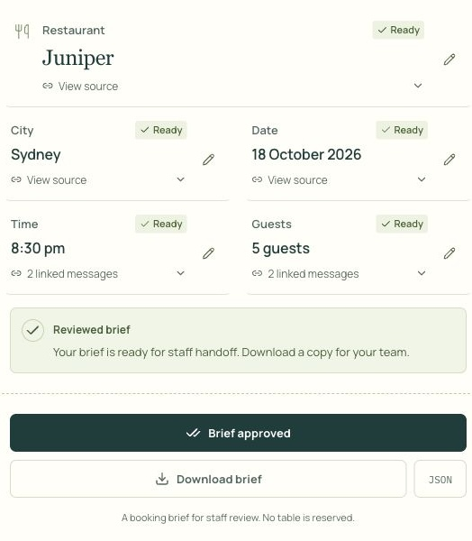
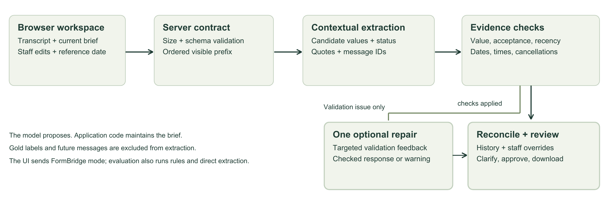
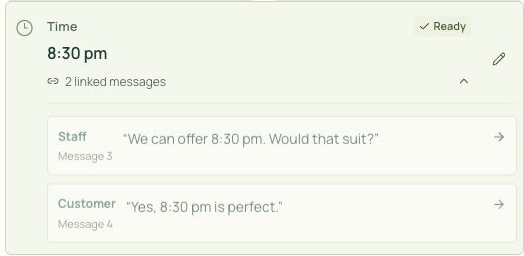
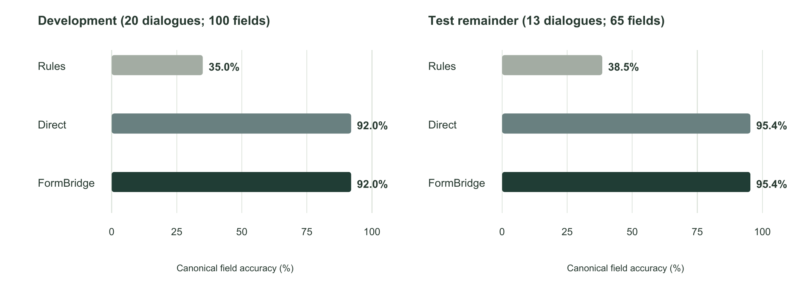
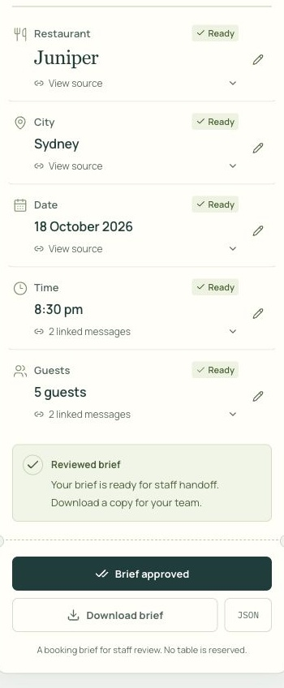
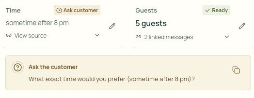
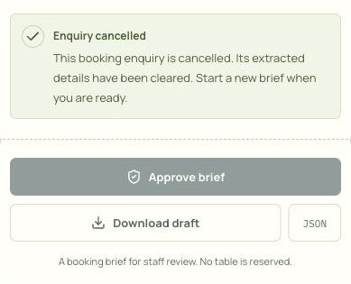

<!-- PAGE 1 -->
# Assignment 2: End-to-end NLP Project
## FormBridge: Restaurant Booking Briefs

**Subject:** 36118 Applied Natural Language Processing

**Student Name:** Karthik Ramesh

**Student ID:** 26043455

<!-- PAGE 2 -->
# Abstract

A restaurant enquiry rarely arrives as a finished form. A customer may change the number of guests, offer a time range or accept a staff suggestion several messages later. FormBridge turns this conversation into an editable booking brief while keeping unresolved details visible. The web application tracks restaurant, city, date, time and party size, links model-derived details to their source messages, records revisions and requires staff approval before handoff.

The project compares a rule-based extractor, direct contextual extraction and FormBridge's contextual extraction with evidence checks and state reconciliation. Evaluation uses a documented restaurant subset of Google's Schema-Guided Dialogue dataset. The final production configuration achieved 100/100 field checks on an inspected 20-dialogue regression sample and 96/100 on a repeatedly used 20-dialogue development selection. In a separate same-model comparison, direct extraction and FormBridge both achieved 92/100 canonical field checks on development data and 62/65 on 13 previously unselected test dialogues. FormBridge produced more consistent representations under the stricter matcher, but also used more tokens and longer replay times.

The application supports review and handoff of a booking brief; it does not reserve a table. Recorded browser checks cover 20 ordinary enquiries and 15 edge cases; native text and JSON downloads were verified. A retrospective source review found clear support for 61 of 62 non-empty predictions, with one ambiguous carryover. Eight of nine reviewed clarification questions addressed the outstanding task; the cancellation follow-up was then corrected. Eight live checks passed after deployment, including four repeated booking tasks with no field errors. No recruited-user study was conducted. Benefits for restaurant staff require participant evaluation.

## Contents

| Section | Page |
| --- | --- |
| 1. Problem, objectives and scope | 3 |
| 2. Application features and user journey | 4 |
| 3. System architecture and state design | 5 |
| 4. NLP methods and technical choices | 6–7 |
| 5. Data sources and preparation | 8 |
| 6. Evaluation design and reproducibility | 9 |
| 7. Results | 10 |
| 8. Findings, errors and challenges | 11 |
| 9. Interaction design and verification | 12 |
| 10. Ethics, limitations and next steps | 13 |
| 11. Project phases, contributions and conclusion | 14 |
| References | 15 |
| Appendices A–D: reproduction and supporting results | 16–20 |

<!-- PAGE 3 -->
# 1. Problem, objectives and scope

## 1.1 The problem and intended users

Consider a customer who asks for four people at seven, then changes the request to five people sometime after eight. Copying the first message into a form gives the wrong brief. Copying the final message alone loses the restaurant, date and city. Choosing 8:30 pm would invent a decision the customer has not made. The task therefore needs both an understanding of language and a record of how the request develops.

FormBridge is intended for small restaurant service teams, particularly staff preparing or handing over enquiries. It places the conversation beside the current booking details so staff can check them together. The workflow was designed from restaurant enquiry scenarios; interviews and adoption testing were outside the project evaluation.

The application addresses dialogue state tracking: maintaining the current set of requested slot values as a conversation progresses. Earlier work such as TRADE models this as generating a dialogue state from utterances, including values outside a fixed ontology (Wu et al., 2019). The Schema-Guided Dialogue dataset provides a relevant task-oriented corpus with service schemas and state annotations (Rastogi et al., 2020). FormBridge builds on this problem formulation and public data, using hosted contextual extraction rather than retraining those research models.

## 1.2 Objectives and research question

The primary objective was to build a web application that gathers five booking details, tracks revisions and lets staff inspect the current request. The technical objectives were to compare rules with contextual extraction, check supporting evidence and dates, and retain the configuration and outputs needed to reproduce the experiments.

**Research question:** How does contextual extraction with evidence checking and state reconciliation compare with rules and direct contextual extraction when maintaining restaurant booking information, and what does that additional structure contribute to staff review?

The question separates value accuracy from interaction quality. A field can match a dataset label while still needing clarification before staff can approve it. Likewise, a visually complete form can be inaccurate. The system therefore measures automatic value agreement separately from the user-facing review workflow.

## 1.3 Scope and success conditions

| Included | Boundary |
| --- | --- |
| Restaurant, city, date, time and guest count | One restaurant reservation enquiry per brief |
| Pasted transcripts and incremental messages | English-language text; up to 30 messages |
| Corrections, uncertainty, source links and history | Exact details stay unresolved when evidence is insufficient |
| Manual review, approval and downloads | Approval prepares information for staff |
| Public web application and local reproduction | No availability search, restaurant contact, payment or table reservation |

Success means that staff can enter an enquiry, inspect the values and their sources, resolve uncertainty and export a reviewed brief. Evaluation covers these functions and automatic extraction within the stated scope. Effects on restaurant operations were not measured.

<!-- PAGE 4 -->
# 2. Application features and user journey

The application starts with an empty workspace. Examples are available through an explicit button, while the main route supports the user's own conversation. A transcript can be pasted with Customer: and Staff: labels, or entered one message at a time. Unlabelled short text is treated as a customer enquiry. Speaker labels matter because a staff offer is not automatically the customer's choice.

*Figure 1. Reviewed booking details and handoff controls. The customer has accepted 8:30 pm for five guests at Juniper, Sydney, on 18 October 2026. Source: original live-app capture, 11 October 2026, using a fictional enquiry.*

## 2.1 From enquiry to reviewed brief

1. **Gather:** Enter four guests, Juniper, Sydney, 18 October 2026 and 7 pm.
2. **Revise:** Change to five guests after 8 pm. Guest count updates; exact time stays open.
3. **Clarify:** Copy the suggested question and add the customer's response.
4. **Check:** After the customer accepts staff's 8:30 pm offer, inspect both time sources.
5. **Hand over:** Review, approve and download text or JSON.

## 2.2 Features that support review

Each field shows a status: Needed, Ask customer, Ready or Reviewed. These combine text and icons, so colour is not the only signal. A source link opens the relevant messages; change history preserves earlier values. Manual edits are labelled as staff input and retained during subsequent analysis. If the conversation later conflicts with an edit, the interface asks staff to review that detail.

Approval requires five resolved, non-empty fields and no unfinished analysis. A semantic change clears prior approval. The approved state says that the brief is ready for handoff, while the interface explicitly states that no table has been reserved. Drafts survive refresh in the current browser tab, and New brief starts the next enquiry.

<!-- PAGE 5 -->
# 3. System architecture and state design

FormBridge uses Next.js 16.3.6, React 19.3.0 and TypeScript 5.9.3, with a Node.js server route on Vercel. OpenAI SDK 7.23.0 supplies contextual extraction, and Zod 4.6.5 defines request and output contracts. The dependency lockfile fixes the installed package versions for reproduction.

*Figure 2. Implemented flow. The model predicts a candidate state; deterministic application code checks evidence and reconciles the brief. A validation-directed repair is limited to one additional model request.*

## 3.1 Separation of responsibilities

The browser owns the transcript, current draft and review controls. POST /api/analyze validates the incoming request before calling the selected analysis method. In the live product, the interface selects FormBridge; rules and direct extraction are available in the technical evaluation runner rather than presented as extra staff-facing modes.

The model receives the ordered, visible conversation and an optional reference date. It returns a candidate for each of the five fields. Application code checks supporting quotations, admissible values, acceptance and recency before updating authoritative state. Clarification questions are generated from deterministic templates, making their relationship to the unresolved field inspectable.

This separation allows the interface, extraction provider and reconciliation code to be changed independently. It also gives tests a stable target: approval, cancellation, evidence checking and manual overrides can be checked without calling a paid model.

## 3.2 State and persistence

A field stores its value, status, constraint, evidence message IDs, source and explanatory note. A brief also stores revision history, its current revision and the revision that was approved. This distinguishes an unanswered field from a stated preference such as “after 8 pm”, and distinguishes an extracted detail from an intentional staff edit.

The draft uses browser session storage and can be downloaded as a local file. The application has no accounts or customer database, so it supports individual review sessions rather than shared inboxes, long-term case histories or cross-device collaboration. External model processing is discussed in Section 10.

The server imposes request-size and schema limits. Its local production rate limiter allows up to 60 requests per minute per observed address within one process. Because serverless instances do not share this map, it is a basic protection rather than a durable global quota. A shared limiter would be necessary for broader operational use.

<!-- PAGE 6 -->
# 4. NLP methods and technical choices

## 4.1 Three approaches to the same task

| Method | Implementation | Reason for including it |
| --- | --- | --- |
| Rules | Regular expressions, number-word conversion, explicit correction patterns and simple acceptance of the preceding staff offer | An interpretable, model-free baseline for explicit booking language |
| Direct contextual extraction | A structured five-field prediction from the complete visible prefix | Tests the benefit of contextual language understanding without FormBridge's evidence reconciliation |
| FormBridge | Contextual candidates with quotations and message IDs, followed by deterministic checks, bounded repair and revision-aware reconciliation | Tests a more inspectable state flow suitable for staff review |

Rules recognise explicit booking phrases and straightforward corrections. Messages are processed in order, with simple acceptance of a preceding staff offer. Restricted patterns limit coverage of varied dialogue; no learned parameters or API tokens are used.

The direct baseline reconstructs value, status and constraint at every customer turn, without evidence citations. Its prompt rejects invented values and unaccepted offers. Both contextual methods target the same five-field task.

FormBridge reconstructs candidates from the same prefix. Browser state supplies staff overrides and history; supporting utterances determine acceptance. Corrections change the brief, not model weights.

## 4.2 Why a hosted LLM and structured output?

Acceptance, correction and omitted context extend beyond simple regular expressions. A hosted model allowed effort to focus on state integrity and review without training or serving new weights. Tradeoffs include network dependency, variable latency and external data processing.

The Responses API parses a Zod-derived output schema. OpenAI distinguishes schema adherence from factual correctness: structured output can still contain mistakes (OpenAI, n.d.-b). FormBridge therefore validates what a candidate is supported by, in addition to whether it is shaped correctly.

The deployed configuration uses GPT-6 Luna for extraction and at most one GPT-6.1 Sol repair, with low reasoning effort. The controlled comparison uses GPT-6 Luna for both approaches and repairs. Primary requests have a 12-second timeout; repairs have a 10-second timeout. SDK retries are disabled. Output budgets are 2,400 tokens for FormBridge and 900 for direct extraction. These model names are provider aliases, so a future rerun may use an updated model.

Luna was retained as the primary model after development trials. An earlier Sol-led 10-dialogue pilot had one terminal failure and longer replay times; its different prompt and repair settings prevent a pure model ranking. Sol is reserved for a second check when validation detects an issue. Low reasoning and one repair limit waiting and usage. The 12- and 10-second limits leave headroom within Vercel's 30-second route limit; disabling SDK retries avoids additional waits. The larger FormBridge output budget accommodates five sets of source quotations. These are engineering choices, not proven optimal settings.

## 4.3 Scope of the model implementation

Retrieval-augmented generation was unnecessary for this task because all required evidence is in the conversation. Fine-tuning, multilingual support and booking integrations were outside scope. The implementation combines an existing language model with evidence checks, uncertainty handling and a staff review workflow.

<!-- PAGE 7 -->
# 4. NLP methods and technical choices, continued

## 4.4 Evidence checking and state reconciliation

For each candidate, the system verifies that cited message IDs exist, quotations occur within those messages and at least one cited message comes from the customer. A value must be supported by a customer statement or by a staff statement with a later customer acceptance. Dates composed across messages receive additional checks. These mechanisms make sources inspectable, but their pattern-based acceptance checks do not establish a perfect understanding of intent.

| Check | Implemented behaviour |
| --- | --- |
| Quote integrity | Reject unknown IDs, duplicate citations, empty quotes and quotations absent from their source messages |
| Value admissibility | Enforce guest counts of 1–30 and bounded field lengths; check calendar dates and exact times |
| Temporal uncertainty | Preserve missing years, alternatives and ambiguous expressions; anchor today/tomorrow only when a valid reference date exists |
| Evidence recency | Prevent older customer evidence from reversing a later semantic correction |
| Explicit clearing | Give cancellation or removal precedence over repeated older predictions |
| Staff control | Retain manual values, flag conflicts and clear approval when review is needed |

If validation finds a repairable inconsistency, the model receives targeted feedback and may return one revised candidate state. It does not receive dataset labels or benchmark answers. A failed repair produces a review warning; the first candidate remains subject to the same checks. If the initial request fails, the last valid brief is preserved and the unfinished update can be retried.

*Figure 3. Expanded Time field linking the 8:30 pm staff offer and the customer's acceptance. Source: original live-app capture, 11 October 2026. An enlarged unresolved-time example appears in Appendix C.*

## 4.5 Distinguishing value agreement from readiness

A historical dataset may label a date as “March 10th” without a year. FormBridge can retain that stated value while asking which year is intended. A correct field under the benchmark can therefore be unready for approval. Inventing a year would improve apparent completeness while reducing trustworthiness.

Evidence checking can miss implicit acceptance or reject a valid correction. A quotation may also be present but misinterpreted. Prompt instructions and pattern filters provide limited protection against adversarial input. The retrospective source audit in Section 6.2 evaluates retained final values; it does not establish reliable evidence interpretation for arbitrary conversations.

<!-- PAGE 8 -->
# 5. Data sources and preparation

## 5.1 Public data and application input

The benchmark source is Google's Schema-Guided Dialogue (SGD) dataset at revision e852981ae34990f4358979625854259302feaa78. Its annotated task-oriented conversations and service schemas make it suitable for evaluating booking state (Google Research, n.d.; Rastogi et al., 2020). The project uses a restaurant subset, not the full multi-domain benchmark.

A reproducible audit identified the following single-service restaurant reservation dialogues. These audited subset counts are distinct from the counts of all dialogues in each upstream split.

| Split | Restaurant service | Audited reservation dialogues | Reservation user turns |
| --- | --- | ---: | ---: |
| Train | Restaurants_1 | 367 | 1,870 |
| Development | Restaurants_2 | 73 | 385 |
| Test | Restaurants_2 | 73 | 342 |

The train split is described in the audit but was not used to fit model weights. Development and test use a different restaurant schema. The loader maps city to location and party_size to number_of_seats for Restaurants_2. Restaurant name, date and time retain their corresponding names. This mapping prevents a schema difference from being mistaken for a missing prediction.

Live application input is user-supplied text, while the browser scenarios and report screenshots use authored examples. Neither represents collected restaurant customer traffic. No customer personal data was required for the project.

## 5.2 Preparation procedure

1. Read the split's dialogue files in stable filename order.
2. Retain conversations containing only the selected restaurant service and at least one ReserveRestaurant user frame.
3. Stop the input prefix at the final reservation user turn, excluding later conversation.
4. Convert USER and SYSTEM speakers to customer and staff, and assign stable message IDs.
5. Map the final annotated slot values to the five application fields. Preserve multiple acceptable label variants.
6. For evaluation, retain prefixes within the 30-message application limit, apply the exclusion list and select the recorded dialogue IDs.

The extractor receives utterances, speakers and message IDs. The annotated reference states are kept outside its input. Historical reference dates are null, so a phrase such as “today” is not silently interpreted using the execution date. Dataset schema defaults are not passed into the model as customer statements.

## 5.3 Fitness, licensing and limitations

SGD is useful for controlled comparison, but its annotations are not a complete ground truth for evidence accuracy, clarification quality or approval readiness. Some slot values carry across revised staff summaries or reflect service conventions. Real staff may reasonably ask for clarification where a dataset retains a value. Section 8 examines this mismatch.

The upstream dataset uses Creative Commons Attribution-ShareAlike 4.0 International. Dataset-derived excerpts require attribution and the applicable licence; the repository retains a copy of the licence. Public availability also means that inclusion in a hosted model's pretraining cannot be ruled out. “Previously unselected” describes this project's evaluation history, not guaranteed absence from provider training.

<!-- PAGE 9 -->
# 6. Evaluation design and reproducibility

## 6.1 Comparing the methods

Rules, direct extraction and FormBridge process the same ordered conversation, with analysis after every customer message. Each method is scored on its final five-field state after the same message. Staff edits are excluded from automatic scoring. The evaluation runs the application analysis code directly, avoiding differences caused by changes to the deployed website.

Two experiments answer different questions. The production-configuration runs check the selected deployable system on the inspected 20-dialogue regression sample and a repeatedly used 20-dialogue development selection. The controlled comparison fixes model identity: both AI systems, including FormBridge's repair, use GPT-6 Luna with low reasoning. The prompts, evidence generation and number of calls differ, so the comparison measures complete systems rather than the isolated effect of validation.

A further controlled run evaluated all 13 eligible test dialogues remaining after excluding 60 previously selected IDs, including interrupted selections. IDs and exclusions were fixed before calls, and prompts and matching rules remained unchanged throughout the runs. These cases had not been selected in earlier project experiments; subsequent reuse would be a regression check.

## 6.2 Metrics and interpretation

For N attempted dialogues, field accuracy is the number of matching final values divided by 5N. Complete-brief accuracy is the number of dialogues in which all five values match divided by N. Failed dialogues remain in both denominators. An absent reference slot matches only a null prediction.

**Strict matching** retains the original text-normalisation rules. **Canonical matching** additionally recognises equivalent supported calendar and clock formats, such as “March 3rd” and “3rd of March”. It does not invent missing years or AM/PM to obtain a match. Both results are reported. This remains a limited value matcher, not human semantic adjudication or the official full-SGD joint-goal metric.

Operational measures include analysis requests, provider attempts, returned input/output tokens, complete-dialogue replay time and repair warnings. Replay time sums requests across several customer turns; it is not the latency of one live message. Concurrent provider use and unreported usage from failed calls limit cost and timing interpretations.

A supplementary retrospective audit inspected all 65 FormBridge field positions in the saved 13-dialogue test remainder. Each non-empty value was checked against its linked messages and visible conversation: explicit customer statements or scoped acceptance counted as supported; disputed carryover counted as ambiguous. Omissions remained separate. Nine clarification questions from the recorded edge cases were judged against the missing detail or customer intent, including cancellation. This was a single review of known outputs, without a second rating. It evaluates source support and question relevance separately from field matching, but does not measure unseen performance or user benefit. Appendix C gives the outcomes and criteria.

## 6.3 Reproduction and verification

Selections, predictions, per-prefix usage and warnings are saved as versioned JSON, with a summary CSV. SHA-256 fingerprints record the extractor and runner used for each experiment. Exact commands and dataset acquisition steps appear in Appendix A.

The final source was checked from a clean archive with fresh locked dependencies: 53 tests, TypeScript checking and a production build passed. GitHub Actions also passed these gates for release 0b6bc90. Saved model predictions support result auditing without another paid run, although provider aliases and stochastic inference limit identical regeneration.

<!-- PAGE 10 -->
# 7. Results

## 7.1 Controlled comparison: same primary and repair model

| Selection and method | Strict fields | Canonical fields | Strict complete briefs | Canonical complete briefs |
| --- | ---: | ---: | ---: | ---: |
| Development, rules | 35/100 | 35/100 | 0/20 | 0/20 |
| Development, direct model | 86/100 | 92/100 | 9/20 | 14/20 |
| Development, FormBridge | 92/100 | 92/100 | 14/20 | 14/20 |
| Previously unselected, rules | 25/65 | 25/65 | 0/13 | 0/13 |
| Previously unselected, direct model | 56/65 | 62/65 | 6/13 | 12/13 |
| Previously unselected, FormBridge | 62/65 | 62/65 | 12/13 | 12/13 |

*Table 1. Final five-field value agreement. Both AI approaches use GPT-6 Luna in these controlled runs. Development uses 20 dialogues; the previously unselected selection contains 13.*

*Figure 4. Canonical field accuracy calculated from the saved comparison reports. Different sample sizes are labelled. The two AI methods tie within each sample.*

Both contextual systems outperform the rule baseline on these selections, reaching 92% canonical field accuracy on development data and 95.4% on the smaller test remainder. FormBridge's advantage under strict matching disappears when equivalent formats are accepted. The difference concerns how values are represented; canonical value accuracy is equal.

## 7.2 Final production configuration

| Selection | Correct fields, strict and canonical | Complete briefs | Terminal dialogue failures |
| --- | ---: | ---: | ---: |
| Inspected regression sample | 100/100 | 20/20 | 0/20 |
| Repeated development selection | 96/100 | 17/20 | 0/20 |

*Table 2. Production configuration: GPT-6 Luna extraction and at most one GPT-6.1 Sol repair. These are separate runs from Table 1.*

The production development run recorded two failed repair calls and retained the checked first-pass state; no dialogue failed completely. The inspected regression score describes performance on known cases. The small samples do not establish general accuracy or a statistically significant advantage over direct extraction.

<!-- PAGE 11 -->
# 8. Findings, errors and challenges

## 8.1 What the results establish

The same-model comparison suggests that contextual understanding is the main source of value accuracy over the rule patterns. On development data, the direct model correctly matched all 20 restaurant names and 15 dates; FormBridge matched 19 names and 16 dates. The aggregate tie therefore conceals different errors. Both achieved 20 city values, 19 times and 18 party sizes.

FormBridge adds evidence links, revision history and explicit review states. Their operational benefit is demonstrated as implemented behaviour, but reduced staff workload or fewer real booking mistakes has not been measured. The additional processing also has a cost.

| Controlled run | Provider attempts | Input / output tokens | Mean whole-dialogue replay |
| --- | ---: | ---: | ---: |
| Development, direct | 166 | 93,947 / 22,893 | 23.835 s |
| Development, FormBridge | 170 | 295,908 / 57,475 | 31.852 s |
| Test remainder, direct | 98 | 55,253 / 11,989 | 20.576 s |
| Test remainder, FormBridge | 101 | 176,247 / 37,395 | 30.754 s |

*Table 3. Returned API usage and mean replay time. Replay time covers multiple customer turns; token totals are observed usage rather than invoiced cost.*

## 8.2 Error review and practical solutions

| Observed issue | Evidence and response |
| --- | --- |
| Implicit carryover | Production development dialogues 1_00005 and 1_00017 omit an annotated date or party size carried from earlier staff summaries. Explicit acceptance and multi-message evidence were added, but carryover remains a weakness. |
| Rejected summaries | Development 1_00006 loses date and party size after a customer rejects one summary and accepts a shorter revision. Test 1_00027 omits three reference slots after repeated corrections; both AI systems make those omissions in the controlled run. |
| Residual scoring sensitivity | Controlled development 4_00069 predicts “the 5th of this month” against “5th of this month”. The matching rule still marks this wording difference wrong; the reported score was not changed. |
| Failed second checks | Two production development repair calls fail. Recovery preserves checked first-pass information and exposes a warning instead of applying unchecked output. |

The four production development mismatches are omissions across three dialogues: two dates labelled “today” and two party-size values of two. These are benchmark mismatches even when preserving uncertainty is sensible for staff. In the test failure, later accepted text states time and city but omits venue, date and size, illustrating the difficulty of interpreting which parts of a rejected summary carry forward.

The source audit found clear support for 61/62 non-empty final values, with one ambiguous date carryover in 4_00026. No clearly invented value was observed; three omitted slots remain in the 65-position denominator. All 12 retained dates without a year remained unready for approval. Eight of nine clarification questions were appropriate. After whole-request cancellation, the remaining question asked for a restaurant as though starting a new enquiry. The fields were correctly cleared, but that question missed the customer's intent. The deployed correction now acknowledges cancellation; the exact case passed on replay (Appendix D).

These reviews distinguish value matching, source support and conversational usefulness. The saved traces omit intermediate candidate decisions, so they cannot assign each error to extraction, repair or reconciliation. No second reviewer checked the source and question ratings.

<!-- PAGE 12 -->
# 9. Interaction design and verification

## 9.1 A review desk designed around the task

On desktop, the conversation appears beside a booking slip. Mobile tabs switch between the two views without discarding the draft. Familiar restaurant terms, cream surfaces and green accents organise the five details, while text and icons identify their status.

Status labels, familiar terms and editable values follow Nielsen's usability principles (Nielsen, 1994). Source links and uncertainty explanations support checking and correcting model output (Amershi et al., 2019). These principles guided the design; recruited participants have not evaluated it.

*Figure 5. Mobile view of the same live enquiry captured on 11 October 2026. The detail statuses, source controls and approval boundary remain visible.*

## 9.2 Verification performed

The recorded browser run passed 20 ordinary enquiries and 15 edge cases covering custom input, corrections, uncertainty, acceptance, cancellation, staff edits, refresh and mobile switching. Passing refers to specified functional checks. A later review found an inappropriate cancellation question. After correction, eight live checks passed: four repeated booking tasks and four cancellation/reopening checks (Appendix D).

Four downloaded files were opened: draft text, approved text, approved JSON and revised draft JSON. Values, transcript, source IDs, history and review status were checked. A correction cleared approval. Native file inspection confirmed delivery despite the missing browser download event.

Labelled controls, a skip link, modal focus handling and reduced-motion support are implemented. No formal accessibility conformance audit has been completed.

## 9.3 What remains unmeasured

The repeated tasks had no errors across 20 field positions. Ten displayed time citations were inspected; both complete briefs were approved and both unresolved briefs stayed blocked. These are browser functional observations. Task time, satisfaction and staff adoption remain unmeasured; a participant comparison is still needed.

<!-- PAGE 13 -->
# 10. Ethics, limitations and next steps

## 10.1 Privacy, accountability and appropriate use

FormBridge's narrow five-field task does not require names, contact details, payment information or dietary and medical information. The live interface warns users to avoid sensitive personal information. However, users can paste arbitrary text, so unnecessary personal information can still be transmitted. Clear instructions alone do not prevent that exposure.

The API key stays on the server. Analysis requests use store: false and do not create a FormBridge customer database. This does not establish zero provider retention. OpenAI documents separate abuse-monitoring and application-state controls, including possible retention and caching (OpenAI, n.d.-a). Browser-local storage therefore does not make model processing local or establish zero retention.

Human approval is a review step; the application has no restaurant availability or reservation connection. Sources are evidence pointers, not a proof of intent. A plausible quotation can still be misinterpreted, and staff may over-trust a complete-looking slip. Explicit uncertainty, manual review and the “no table is reserved” boundary reduce that risk without eliminating it.

## 10.2 Limits of the evidence

The samples are small and domain-restricted. Development cases were repeatedly used; the regression selection was inspected. The 13-case remainder provides some separation from this project's earlier selections, but one dialogue changes its complete-brief percentage by 7.7 points. Its public provenance also prevents claims of guaranteed absence from model pretraining.

The controlled experiment fixes model identity, but evidence prompts and repair budgets differ. It cannot isolate validation as the causal source of improvement. Values are scored at the final turn. The supplementary source and clarification audit uses known outputs, one reviewer and a small selection; it cannot establish unseen support precision or inter-rater reliability. Intermediate-turn accuracy remains unquantified. The canonical scorer still misses harmless wording differences. API aliases, concurrent provider use and incomplete failed-call token reporting limit regeneration and cost conclusions.

English-only patterns, a 30-message cap and party sizes of 1–30 limit applicability. Tab-local storage and a process-local limiter suit the current demonstration but do not establish production-scale reliability. A complete security or legal compliance assessment was outside the project evaluation.

## 10.3 Prioritised next steps

1. **Evaluate the review workflow with people.** Measure task errors, time and how often sources are checked; recruit restaurant staff where feasible.
2. **Improve diagnostic evidence.** Log redacted candidate/check decisions for research, label carryover and rejection scope, and add independent evidence and clarification annotations.
3. **Run a stronger controlled experiment.** Freeze a new dataset or collection before tuning; compare prompts and repair budgets, then ablate evidence validation separately.
4. **Reduce operational overhead.** Test compact context and repair policies, measuring quality alongside per-message latency and observed usage.
5. **Prepare for shared use.** Add consent-aware persistence, a durable shared rate limiter and suitable access controls only when a real staff workflow requires them.

These priorities address the observed extraction errors, unmeasured user benefits and limits of individual browser sessions.

<!-- PAGE 14 -->
# 11. Project phases, contributions and conclusion

## 11.1 Phases and delivered work

| Phase | Recorded period | Delivered evidence |
| --- | --- | --- |
| Scope and initial implementation | 29 September | Five-field state model, rule baseline, contextual extraction and initial web interface |
| Public workflow and product communication | 30 September | Public access, custom enquiries, empty initial workspace and separation of internal evaluation |
| Extraction and interaction refinement | 1 October | Grounding and temporal checks, cancellation handling, retained staff edits, focus handling and restaurant desk design |
| Final evaluation and reproduction | 1 October | Fixed evaluation settings, same-model comparison, result files, clean-checkout checks and verified exports |
| Product media and report preparation | 4–11 October | Updated launch/walkthrough films, real product captures and the technical report |
| Report audit and targeted correction | 11 October | Source and question review, corrected cancellation follow-up and eight deployed task checks |

*Table 4. Project phases and deliverables recorded in the repository.*

## 11.2 Individual contributions

Karthik Ramesh was responsible for technical implementation. The delivered technical work includes the web application, analysis pipeline, evaluation runner, deployment and supporting product media.

## 11.3 Conclusion

FormBridge demonstrates an end-to-end NLP application for a specific task: converting changing restaurant enquiries into reviewable booking briefs. It combines contextual state extraction with source checking, revision handling and human approval in a working web interface. The main contribution is making extracted information inspectable and actionable within that review task.

Both contextual approaches exceeded the rule baseline, and their canonical value accuracy was equal on the controlled selections. FormBridge added source links, uncertainty handling and review controls at the cost of more tokens and longer replay times. Testing whether those controls reduce staff errors is the next step. The project demonstrates how dialogue state tracking can support a restaurant booking handoff while leaving the final decision with staff.

<!-- PAGE 15 -->
# References

Amershi, S., Weld, D., Vorvoreanu, M., Fourney, A., Nushi, B., Collisson, P., Suh, J., Iqbal, S., Bennett, P. N., Inkpen, K., Teevan, J., Kikin-Gil, R., & Horvitz, E. (2019). Guidelines for human-AI interaction. In *Proceedings of the 2019 CHI Conference on Human Factors in Computing Systems* (pp. 1–13). Association for Computing Machinery. https://doi.org/10.1145/3290605.3300233

Google Research. (n.d.). *Schema-Guided Dialogue dataset* [Data set; revision e852981ae34990f4358979625854259302feaa78]. GitHub. https://github.com/google-research-datasets/dstc8-schema-guided-dialogue/tree/e852981ae34990f4358979625854259302feaa78

Nielsen, J. (1994, April 24). *10 usability heuristics for user interface design*. Nielsen Norman Group. https://www.nngroup.com/articles/ten-usability-heuristics/

OpenAI. (n.d.-a). *Data controls in the OpenAI platform*. Retrieved October 11, 2026, from https://developers.openai.com/api/docs/guides/your-data

OpenAI. (n.d.-b). *Structured model outputs*. Retrieved October 11, 2026, from https://developers.openai.com/api/docs/guides/structured-outputs

Rastogi, A., Zang, X., Sunkara, S., Gupta, R., & Khaitan, P. (2020). Towards scalable multi-domain conversational agents: The Schema-Guided Dialogue dataset. *Proceedings of the AAAI Conference on Artificial Intelligence, 34*(5), 8689–8696. https://doi.org/10.1609/aaai.v34i05.6394

Wu, C.-S., Madotto, A., Hosseini-Asl, E., Xiong, C., Socher, R., & Fung, P. (2019). Transferable multi-domain state generator for task-oriented dialogue systems. In A. Korhonen, D. Traum, & L. Màrquez (Eds.), *Proceedings of the 57th Annual Meeting of the Association for Computational Linguistics* (pp. 808–819). Association for Computational Linguistics. https://doi.org/10.18653/v1/P19-1078

<!-- PAGE 16 -->
# Appendix A. Reproducing the application and evaluation

## A.1 Application and source

Prerequisites are Node.js 24, pnpm 11.24.0, Git, repository access and an OpenAI API project with access to the configured models. Installation and build do not require an API key; model analysis does.

~~~bash
git clone https://github.com/KarthikRamesh9149/NLP-AT2.git
cd NLP-AT2
git checkout 0b6bc901363b34472173ff7a05d5366f7bd5549c
pnpm install --frozen-lockfile
cp .env.example .env.local
~~~

Edit .env.local and set OPENAI_API_KEY to your own project key before model analysis. Keep this file private. Then run:

~~~bash
pnpm test
pnpm typecheck
pnpm build
pnpm start
~~~

The application runs at http://localhost:3000. The foreground pnpm start process occupies this terminal. Open another terminal in NLP-AT2 for the commands below, or stop the server first: in-process evaluation does not require it. The evaluation used source commit 32af459b6a1cd20ede9b08c2b73c20a0c385301e; the release above has unchanged extractor and runner fingerprints.

## A.2 Dataset and same-model development comparison

~~~bash
git clone https://github.com/google-research-datasets/dstc8-schema-guided-dialogue.git ../formbridge-sgd
git -C ../formbridge-sgd checkout e852981ae34990f4358979625854259302feaa78
pnpm data:audit ../formbridge-sgd

OPENAI_MODEL=gpt-6-luna \
FORMBRIDGE_MODEL=gpt-6-luna \
FORMBRIDGE_REPAIR_MODEL=gpt-6-luna \
node --env-file=.env.local --import tsx scripts/evaluate.ts ../formbridge-sgd \
  --transport=in-process --replay=all-user-turns \
  --split=dev --sample=20 --modes=rules,model,formbridge \
  --selection=evaluation/results/selection-grounded-v6-release-heldout-development.json \
  --tag=report-reproduce-equal-development
~~~

Each run needs a unique tag because completed results and selection manifests refuse overwrites. All systems receive identical customer prefixes, and the extractor receives no reference values. A repeat uses previously evaluated data and constitutes a reproduction attempt.

## A.3 Reading outputs

The runner writes a selection manifest before inference and a completed result file containing values, strict/canonical matches, brief states, prefix usage, latency and warnings. The manifest and source fingerprints identify the configuration associated with each completed result.

Provider alias updates and inference variability may change a rerun's outputs. The saved JSON and CSV permit inspection of the reported findings without new API requests.

<!-- PAGE 17 -->
# Appendix A. Reproduction, continued

## A.4 Previously unselected test comparison

~~~bash
OPENAI_MODEL=gpt-6-luna \
FORMBRIDGE_MODEL=gpt-6-luna \
FORMBRIDGE_REPAIR_MODEL=gpt-6-luna \
node --env-file=.env.local --import tsx scripts/evaluate.ts ../formbridge-sgd \
  --transport=in-process --replay=all-user-turns \
  --split=test --sample=13 --modes=rules,model,formbridge \
  --exclude=evaluation/research/exclude-prior-test-20261001.json \
  --seed=assessment-unselected-20261001 \
  --tag=report-reproduce-equal-test
~~~

The exclusion file contains 60 previously selected test IDs, including interrupted runs. The remaining 13 were selected before the final comparison. Subsequent runs reuse that same selection.

## A.5 Production-configuration checks

For the two production checks, use GPT-6.1 Sol as the repair model. The two commands below reuse the original sample selections.

~~~bash
OPENAI_MODEL=gpt-6-luna \
FORMBRIDGE_MODEL=gpt-6-luna \
FORMBRIDGE_REPAIR_MODEL=gpt-6.1-sol \
node --env-file=.env.local --import tsx scripts/evaluate.ts ../formbridge-sgd \
  --transport=in-process --replay=all-user-turns \
  --split=test --sample=20 --modes=formbridge \
  --selection=evaluation/results/selection-grounded-v6-release-regression.json \
  --tag=report-reproduce-production-regression

OPENAI_MODEL=gpt-6-luna \
FORMBRIDGE_MODEL=gpt-6-luna \
FORMBRIDGE_REPAIR_MODEL=gpt-6.1-sol \
node --env-file=.env.local --import tsx scripts/evaluate.ts ../formbridge-sgd \
  --transport=in-process --replay=all-user-turns \
  --split=dev --sample=20 --modes=formbridge \
  --selection=evaluation/results/selection-grounded-v6-release-heldout-development.json \
  --tag=report-reproduce-production-development
~~~

## A.6 Interface and download reproduction

Live application: https://formbridge-nlp-at2.vercel.app/

Start with a new brief; enter the four-message enquiry from Section 2 with a valid future date. Confirm four guests and 7 pm, then five guests and an unresolved after-8 preference, then accepted 8:30 pm. Inspect both time sources. Approve the resolved brief and download text and JSON; open the files and check the values and reviewed status. Add a further correction and confirm that approval clears. Refresh and inspect the restored draft. Downloads can be checked directly from the saved files.

<!-- PAGE 18 -->
# Appendix B. Evidence index

## B.1 Where to verify the findings

Paths below are relative to the application repository.

| Evidence | File or location |
| --- | --- |
| Evaluation settings and sample selection | evaluation/research/assessment-final-protocol.md |
| Verified results and accounting | evaluation/research/assessment-final-verification.md |
| Aggregate tables | evaluation/results/assessment-summary.csv and assessment-summary.json |
| Production regression | evaluation/results/sgd-test-20-assessment-final-regression.json |
| Production development | evaluation/results/sgd-dev-20-assessment-final-development.json |
| Same-model development | evaluation/results/sgd-dev-20-assessment-equal-model-development.json |
| Same-model test remainder | evaluation/results/sgd-test-13-assessment-equal-model-unselected.json |
| Model-selection development trials | evaluation/results/sgd-dev-10-grounded-luna-pilot.json; evaluation/results/sgd-dev-10-grounded-v3-development.json |
| Dataset audit and licence | evaluation/results/sgd-audit.json; evaluation/DATA_LICENSE.txt |
| Authored browser cases | evaluation/browser-cases-35.json |
| Recorded 35-case browser run | evaluation/results/browser-use-35-final.json |
| Source and clarification review | docs/assessment/feature-audit.json |
| Live task checks and post-fix replay | docs/assessment/browser-task-checks-20261011.json; docs/assessment/browser-task-retest-20261011.json |
| Participant tasks and recording sheet | docs/assessment/Usability-study.md; docs/assessment/usability-observations.csv |
| Native exports and file checks | evaluation/results/download-verification-20261001.json; evaluation/results/downloads/ |
| Full reproduction instructions | evaluation/REPRODUCIBILITY.md |
| Automated release checks | GitHub Actions run 37173880400, release 0b6bc90 |

Source fingerprints are recorded in the completed evaluation files. The 35-case record covers an earlier release. The 11 October replay used b256d49; its cancellation presentation change leaves the recorded extractor fingerprint unchanged.

## B.2 Evidence provenance

Error analysis used development dialogues 1_00005, 1_00006 and 1_00017, and test dialogue 1_00027 from the pinned SGD revision. The original labels and final run scores were retained. Figure 4 uses the saved summary CSV; field-level observations use the saved predictions. Dataset-derived material is attributed to Google Research and is subject to the dataset's Creative Commons Attribution-ShareAlike 4.0 International licence.

Figures 1, 3 and 5 are original captures of the live application on 11 October 2026 using a fictional restaurant enquiry. They illustrate the interface without including customer records. Figure 2 describes the implemented processing flow.

The source/clarification review retains predicted values, source IDs, visible messages and rating rationales in feature-audit.json. Run verify-feature-audit.py in docs/assessment with Python 3 to check input correspondence and recount annotations without API calls. The script verifies accounting, not the correctness of the semantic ratings.

<!-- PAGE 19 -->
# Appendix C. Source support and clarification review

## C.1 Criteria and results

The source review used the unchanged final predictions for all 13 test-remainder dialogues and their original visible prefixes at the pinned SGD revision. A value counted as supported when the cited messages established a customer statement or an accepted staff value. Conflicting or incomplete acceptance scope was labelled ambiguous. Null predictions were omissions and were excluded from support precision, while remaining in field-accuracy denominators. This single retrospective review was not blind to results and had no independent second rater.

| Measure | Observed result |
| --- | ---: |
| Fields inspected | 65 |
| Non-empty values with valid cited IDs | 62/62; 171 citation references |
| Values with clear source support | 61/62 (98.4%) |
| Ambiguous support | 1/62 (1.6%) |
| Clearly unsupported values observed | 0/62 |
| Omitted reference slots | 3/65 (4.6%) |
| Retained year-missing dates marked unresolved | 12/12 |
| Appropriate clarification questions | 8/9 (88.9%) |

For 4_00026, March 1st appears in a staff summary that the customer corrects for party size and time. The later acceptance confirms only those changes. Carrying the date forward is plausible, but its support is less explicit than a direct reconfirmation. It is therefore counted as ambiguous despite matching the dataset label.

Question review covered E01–E05, E07–E08 and E10–E11 in the existing browser record. A question needed to request the missing detail without choosing an unaccepted value. After whole-request cancellation, the criterion instead required acknowledging cancellation. E07 cleared all five fields but asked “Which restaurant would you like?”; it failed that conversational criterion. The other eight questions addressed the missing or uncertain detail. The authored functional pass count is unchanged because the original checks did not include this criterion.

## C.2 Uncertainty in the interface

*Figure 6. The customer changes to five guests after 8 pm. The exact time remains open and the suggested question preserves the constraint. Source: original live-app capture, 11 October 2026.*

<!-- PAGE 20 -->
# Appendix D. Live task replay after correction

## D.1 Method and observed outcomes

The public app was tested through its mobile interface on 11 October 2026 at release b256d49. Fictional conversations underwent live analysis; checks inspected values, time sources, questions and approval. A1/B1 accept offers and revise guest counts; A2/B2 reject offers and retain time preferences. All four passed before and after correction.

| Check | Required outcome | Observed outcome |
| --- | --- | --- |
| A1: Juniper, Sydney | 18 Oct 2027; 7:30 pm; five guests | Correct; two time sources; approved |
| B1: Willow House, Melbourne | 19 Oct 2027; 6:45 pm; three guests | Correct; two time sources; approved |
| A2: Cedar Table, Adelaide | 20 Oct 2027; six guests; after 8 pm, exact time open | Correct; three time sources; approval disabled |
| B2: Olive & Thyme, Brisbane | 21 Oct 2027; four guests; after 7 pm, exact time open | Correct; three time sources; approval disabled |
| C1/C2: cancel, then courtesy reply | Clear all five fields; acknowledge cancellation | Both passed; no new-booking question |
| C3: new booking after cancellation | Use five new values rather than cancelled details | All five correct; approval available |
| E07: exact original cancellation case | Replace the inappropriate restaurant question | Passed; cancellation acknowledged; approval disabled |

The four repeated booking tasks had zero errors across 20 field positions and ten inspected time citations. All eight specified checks passed. This is functional verification using authored tasks, with no human participants, manual comparison, satisfaction ratings or task-time measure. It does not establish general usability or perfect accuracy.

## D.2 Correction and evidence

The original E07 result remains in Appendix C. When all five fields are cleared and linked to a whole-request cancellation, the response and interface acknowledge it without asking for a restaurant. Six added tests cover cancellation, courtesy replies, reopening, refusal to reopen, partial clearing and retained staff details. All 59 tests, TypeScript checks and the production build passed. Extraction and scoring were unchanged; dataset results remain the earlier runs.

*Figure 7. Corrected live cancellation response, 11 October 2026. The original failing question and the successful replay are retained separately.*

Transcripts and observed states are retained in browser-task-retest-20261011.json. Download delivery was not retested.
