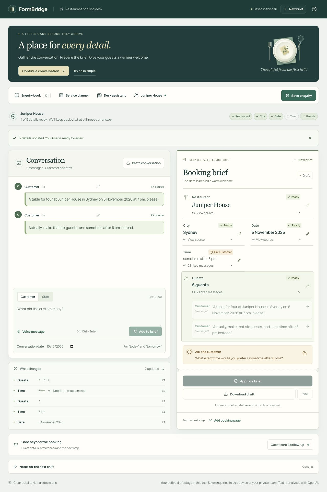
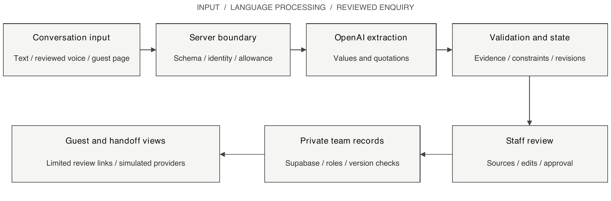
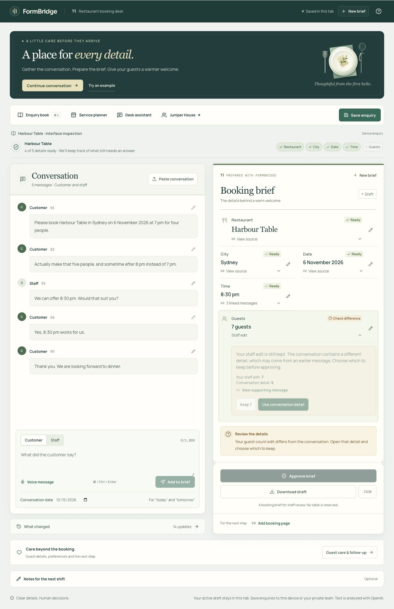

<!-- PAGE 1 -->
# Assessment Task 2
## FormBridge Restaurant Enquiry Workspace

**Report:** Group project technical report

**Subject:** 36118 Applied Natural Language Processing

**Submitted by:** Karthik Ramesh

**Student ID:** 26043455

| Group member | Student ID |
| --- | --- |
| Karthik Ramesh | 26043455 |
| Avanish Rao | |
| Pranav Chhetri | |
| Shivom Karnad | 25977543 |
| Rishi Mundra | |

<!-- PAGE 2 -->
# Abstract

FormBridge turns restaurant enquiry conversations into booking briefs that staff can review and share. It tracks restaurant, city, date, time and guest count as customers change their plans. Each extracted value links to its source, while unresolved details remain visible as questions. Staff can correct the brief, save it to a private team and ask the guest to review it. Voice transcription and guest-care suggestions support this workflow. External messaging, reservation transfer and email recovery remain simulations.

We compared rules, direct model extraction and FormBridge on 20 previously examined development dialogues from the Schema-Guided Dialogue dataset. Allowing for equivalent date and time formats, the methods matched {{DEV_RULES}}/100, {{DEV_DIRECT}}/100 and {{DEV_FB}}/100 fields respectively. FormBridge matched all five fields in {{DEV_COMPLETE}}/20 dialogues, with approximately twice the mean replay time of direct extraction. A separate regression check matched {{REG_FB}}/100 fields on 20 previously examined test dialogues. These small, inspected samples do not establish accuracy on unseen enquiries.

A controlled comparison exposed a limitation: validation reduced correct fields from 88/100 to 85/100 when applied to identical model responses. Twenty constructed cases passed the specified uncertainty, clarification and approval checks; all 93 populated fields included the required source messages. Development testing also covered 20 interface checks, leading to clearer conflict wording and better links between form controls and their instructions. This inspection provides evidence of working interactions; learnability, satisfaction and time savings remain unmeasured.

## Contents

| Section | Page |
| --- | --- |
| 1 Problem and objectives | 3 |
| 2 Product and user journey | 4 |
| 3 Architecture and state | 5 |
| 4 NLP methods and choices | 6 |
| 5 Data and preparation | 7 |
| 6 Evaluation design | 8 |
| 7 Results and resource use | 9 |
| 8 Error analysis and development findings | 10 |
| 9 Interaction design | 11 |
| 10 Functional verification | 12 |
| 11 Ethics and limitations | 13 |
| 12 Project delivery and next steps | 14 |
| References | 15 |
| Appendices A to F | 16–22 |

<!-- PAGE 3 -->
# 1 Problem and objectives

## The restaurant enquiry problem

A customer asks for four people at seven, then changes the request to five people sometime after eight. The guest count is now clear, but the exact time is not. Reading only the first message produces an outdated summary; reading only the last loses the restaurant and date. Choosing 8:30 pm would introduce a decision the guest has not made.

This is a dialogue state tracking problem: maintaining what a customer currently wants as a conversation progresses. TRADE, for instance, derives state values from the conversation rather than a fixed list of answers (Wu et al., 2019). The Schema-Guided Dialogue dataset provides service descriptions, conversations and annotated states to evaluate this task (Rastogi et al., 2020).

We selected restaurant enquiries because a missed correction has a clear consequence. Front-of-house staff need to pass the current request to a colleague without losing a change or special requirement. Guests also need a way to check that their plans have been understood. These enquiry scenarios informed the design; restaurant interviews have not yet established demand or confirmed the assumed needs.

## Objectives and research question

We aimed to build a web application that gives staff accurate booking information and lets them check it against the conversation. The project had four objectives:

1. Maintain restaurant, city, date, time and guest count as messages change.
2. Show the messages supporting each value and ask for clarification where details remain uncertain.
3. Compare rules with contextual extraction using a reproducible evaluation.
4. Support intake, staff review and team handoff, with private records and recovery from failed updates.

**Research question:** How accurately does FormBridge maintain booking details compared with rules and direct model extraction, and how can those details support staff review?

## Scope and completion criteria

FormBridge accepts English text and short voice messages. A transcript may contain up to 30 messages, each limited to 1,000 characters. Optional guest-care details sit alongside the five booking fields. Staff can save enquiries on their device or in a private team workspace, assign them to a colleague and request a guest review.

A completed workflow results in staff having a brief describing the current request, unanswered questions, and review decisions. Approval indicates that the brief was reviewed; it does not reserve a table. Emails, WhatsApp, and reservation connections are simulated. Since these workflows go beyond the five fields in the dataset, we assess them separately from extraction accuracy.

<!-- PAGE 4 -->
# 2 Product and user journey

Staff begin with an empty booking desk. They can type or paste a conversation, reopen a saved enquiry or review a voice transcript before adding it. Restaurants can publish a branded guest page or embed the assistant on their website. The assistant collects enquiry details and answers questions from the restaurant's approved information. Contact details reach the team only after the guest gives consent and submits the enquiry.

*Figure 1. The booking desk after a customer changes four guests to six and replaces 7 pm with “sometime after 8 pm”. The guest count updates while the exact time remains unresolved. Screenshot of the live application, 13 October 2026.*

## A complete enquiry

In Figure 1, the restaurant, city and date are retained. Staff can inspect the conversation and change history, then ask for an exact time. An offer of 8:30 pm becomes an agreed time only after the customer accepts it. Once all five details are resolved, staff can approve the brief.

A shared enquiry can include contact information, accepted guest-care requests, an owner and a due time. Through a private link, the guest can confirm the details or request a correction. A correction becomes a new customer message, removes the previous approval and returns the enquiry to Needs reply. The simulated reservation connector demonstrates handoff and recovery from a failed transfer.

## Work beyond the first reply

The team desk provides comments, priorities, assignments and reminders. Staff explicitly choose whether to link or merge returning-guest records, since similar names do not establish that two records belong to the same person. A service planner groups enquiries by date; the desk assistant drafts replies and handoff notes for review.

Device sign-in and private invitations provide access to shared workspaces. A separate preview demonstrates email registration and password recovery. Real email delivery still requires a configured sender and end-to-end verification.

<!-- PAGE 5 -->
# 3 Architecture and state

We used Next.js 16.3.6, React 19.3.0 and TypeScript 5.9.3 to build the application, deployed on Vercel. OpenAI SDK 7.23.0 handles language and transcription requests, while Zod 4.6.5 checks input and response formats. Supabase provides sign-in and PostgreSQL storage, with access rules applied to individual records. The dependency lockfile records the installed versions.

*Figure 2. Application architecture. Model output is checked before it changes the brief. Shared workspace reads and changes require membership; the public booking desk works independently. External messaging and reservations use simulations.*

## Keeping the brief consistent

The model proposes field values, uncertainty and supporting messages. Application code checks these proposals against the conversation before updating the brief. Each field is marked missing, resolved or waiting for clarification, with its origin recorded as a model output or staff edit. Approval belongs to a specific revision. Changing the request removes the existing approval until staff review and approve the revised brief.

The active draft is stored in the browser session storage. The local library stores up to 50 saved enquiries whilst shared enquiries are stored in Supabase and are limited to team members. The guest's preferences and comments are stored separately from the five extracted fields. Imported JSON and old drafts containing model predictions should be rechecked before approval.

## Handling shared edits and failed requests

Each save includes the enquiry version. If a teammate has changed the record, the application warns that the saved version is newer. Unrelated changes can be combined; fields edited by both people require a choice. Model requests also stay associated with their original enquiry, so a delayed response cannot update a different open case.

Before an OpenAI request, the server checks the input and reserves an estimated amount from the shared allowance. Reported usage adjusts that reservation; when a request fails without usage information, the original reservation is retained. If the allowance database is unavailable, AI requests stop. Local drafts and manual review remain available, while loading or saving shared enquiries still depends on Supabase. This allowance limits application usage, not all spending on the OpenAI account.

<!-- PAGE 6 -->
# 4 NLP methods and choices

## Three approaches to booking state

*Table 1. Approaches to booking-state extraction.*

| Approach | Method | Purpose |
| --- | --- | --- |
| Rules | Regular expressions, number-word conversion and simple correction or acceptance patterns | An interpretable baseline without model calls |
| Direct extraction | The model predicts five values from the conversation so far | Tests contextual extraction with minimal processing after the model response |
| FormBridge | The model proposes values and quotations; code checks them before updating the brief | Adds sources, uncertainty and controlled updates for staff review |

All three approaches receive the same messages with customer and staff labels. FormBridge checks whether quoted messages exist, whether their wording supports the proposed value and whether a later message changes it. It also checks customer acceptance, dates, time constraints, guest counts and cancellation. Manual edits are preserved, with later conflicts referred to staff.

Structured output gives the model response a predictable format, but its content can still be wrong (OpenAI, n.d.-b). For example, “after 7 pm” must remain a time preference, and the numeral in a time must not become a guest count. Validation checks for these errors. The checks can also reject a valid paraphrase or miss an acceptance, which makes their own effect worth evaluating.

## Model and latency choices

The deployed configuration uses gpt-6-luna for the initial extraction. It permits a second call to gpt-6.1-sol to repair the response or recover from a temporary failure. Both use low reasoning effort. SDK retries are disabled, and the output allowances are 2,400 tokens for FormBridge and 900 for direct extraction.

A ten-dialogue Luna trial matched 45/50 fields with no failed dialogues and averaged 27.78 seconds per conversation. A later trial using Sol first and Astra for repair matched 38/50 fields on the same dialogues. One dialogue failed; the nine completed dialogues averaged 52.39 seconds. These results favoured retaining Luna as the practical starting point. Prompts and validation also changed between trials, so the comparison cannot establish which model is intrinsically better. Appendix E records both configurations.

The first call has a limit of 12 seconds and the additional call has a limit of 14 seconds, leaving room for application processing within the 30-second request limit. However, the separate benefit of Sol repair has yet to be measured. Using a hosted model avoids the need for training and hosting model weights, but introduces network dependence and external data processing. The model names are aliases, and their behaviour may change over time.

## Language features around the brief

Voice input uses `gpt-transcribe`, and staff review its transcript before adding it to the conversation. Guest-care suggestions include customer quotations and require individual acceptance. The desk assistant proposes notes and follow-ups for review. Answers to restaurant questions use matching categories of approved information and acknowledge when an answer is unavailable.

<!-- PAGE 7 -->
# 5 Data and preparation

## Dataset and mapping

We evaluated extraction using Google's Schema-Guided Dialogue dataset (Google Research, n.d.). We retained conversations about one restaurant service that included a customer turn labelled `ReserveRestaurant`. Table 2 shows the eligible subset before applying the application's 30-message limit. Appendix B identifies the exact dataset revision.

*Table 2. Eligible restaurant conversations before applying the message limit.*

| Split | Restaurant service | Eligible dialogues | Reservation customer turns |
| --- | --- | --- | --- |
| Train | Restaurants_1 | 367 | 1,870 |
| Development | Restaurants_2 | 73 | 385 |
| Test | Restaurants_2 | 73 | 342 |

The training schema uses `city` and `party_size`; the development and test schemas use `location` and `number_of_seats`. The loader maps both to the application's city and guest-count fields. Restaurant name, date and time complete the five-field task. No model weights were trained on these data.

## Preparing each example

The loader reads the dataset files in a fixed order and stops each selected conversation at its last customer turn labelled ReserveRestaurant for the selected service. It maps USER to customer and SYSTEM to staff, and assigns message identifiers. The final annotated state supplies the expected answers for scoring. Each approach processes every customer turn using only the conversation available up to that point, known as a conversation prefix.

Expected answers, service-schema defaults and future messages are excluded from model input. Dataset conversations have no reference date, so relative dates such as “tomorrow” must not be resolved using the experiment date. A yearless date can be retained as a value while requiring clarification before approval.

## Other inputs and data limitations

The live application accepts user conversations, reviewed voice transcripts and approved restaurant information. Product screenshots, constructed feature cases and interface checks use fictional enquiries. The dataset experiments use SGD conversations. Its five state labels support value scoring, but do not label guest-care features, source quality or staff workflows. Expected supporting messages and clarification targets were specified separately for the constructed cases; staff workload was not measured. We did not train model weights, and cannot establish whether the public dataset appeared in the hosted models' training data. The samples were inspected during development, so reruns test regression rather than unseen accuracy.

The upstream dataset uses the Creative Commons Attribution-ShareAlike 4.0 International licence. Dataset-derived material retains its attribution and licence information. The evaluation records also identify the dataset revision.

<!-- PAGE 8 -->
# 6 Evaluation design

## Comparing the three systems

We ran the released extraction code on two previously examined samples: 20 development dialogues for all three methods and 20 test dialogues for FormBridge regression testing. The dialogue selections were saved before making API calls. Appendices A and B provide the code version, configuration and selected conversations.

All methods see identical ordered conversation prefixes and finish at the same customer turn. Direct extraction and FormBridge use GPT-6 Luna as the primary model. FormBridge also permits a Sol repair or recovery and requests quotations. This compares complete systems, with different prompts, output allowances and call counts.

## Controlled component and feature checks

For the controlled comparison, one model response was requested at the end of each development conversation. The same response was scored before and after validation, with no repair call or previous predicted state. This isolates the effect of those checks on the retained proposals. One request timed out and counts as a failure in both conditions.

Twenty constructed conversations tested booking corrections, customer acceptance, cancellations, dates, guest counts and uncertainty. Expected values, statuses, supporting messages and clarification targets were recorded before the calls and excluded from model input. Each transcript was processed from an empty brief. These cases test the required sources, question targets and approval eligibility. They used 20 primary calls and did not exercise repair calls.

## Metrics

Field accuracy counts correct final values across five fields per attempted dialogue: 20 dialogues give 100 checks. Complete-brief accuracy counts dialogues in which all five values match. Failed dialogues remain in both denominators, and staff edits are excluded.

The strict matcher normalises text. The canonical matcher also accepts equivalent date and time formats, while preserving missing years and the distinction between a range and an exact time. Both scores are reported. They measure the selected five fields, not the full SGD task or whether a brief is ready for approval.

Resource accounting records provider requests, observed tokens and whole-dialogue replay time. A replay contains several conversation prefixes, so its duration is not per-message latency. Failed requests may lack usage records; the observed token totals are not billing statements.

## Reproduction and interpretation

The evaluation calls the application's extraction functions with real OpenAI requests. Separate browser checks test the deployed interface. Saved results include predictions, failures and settings, with code checksums to identify the tested version. Appendices B and E explain how to repeat the experiments and which files are checked for changes. Hosted models can return different answers on a later run even when the code is unchanged.

<!-- PAGE 9 -->
# 7 Results and resource use

## Development comparison

All three methods completed the 20 development dialogues on 13 October 2026. Table 3 reports 100 field checks per method; a complete brief requires all five values to match.

*Table 3. Development accuracy on 20 dialogues.*

| Method | Strict fields | Canonical fields | Strict complete | Canonical complete |
| --- | --- | --- | --- | --- |
| Rules | 35/100 | 35/100 | 0/20 | 0/20 |
| Direct Luna | 83/100 | 89/100 | 6/20 | 11/20 |
| FormBridge | 97/100 | 97/100 | 17/20 | 17/20 |

FormBridge matched eight more fields and six more complete briefs than direct extraction under canonical scoring. Both found every restaurant and city; dates and guest counts accounted for most differences. The result includes differences in prompts, response formats and additional calls. Validation is examined separately below.

## Effect of validation on identical proposals

*Table 4. The same model responses scored before and after validation.*

| Condition | Canonical fields | Complete briefs |
| --- | --- | --- |
| Original model proposal | 88/100 | 14/20 |
| Same proposal after validation | 85/100 | 12/20 |

One request timed out, counting as five wrong fields in each condition. Validation gained one match but rejected four correct values, reducing accuracy. Section 8 examines these losses.

## Processing time and API usage

Each method processed 166 partial conversations. Direct extraction made 166 OpenAI requests, using 93,947 input and 21,817 output tokens. FormBridge made 196 requests and recorded 381,706 input and 61,309 output tokens. Three dialogues recovered after failed requests without usage information. The recorded total excludes any unreported usage from those attempts.

Processing a whole dialogue averaged 21.87 seconds for direct extraction and 45.11 seconds for FormBridge, approximately twice as long. These measurements cover all steps, not one message. Concurrent evaluation activity also limits the timing comparison. Rules required no API calls.

## Regression results

The previously examined test selection matched 100/100 fields and 20/20 complete briefs under both matchers. FormBridge made 149 calls across 137 partial conversations, recording 289,466 input and 50,732 output tokens. Processing averaged 32.93 seconds per dialogue, with no failures or missing usage records.

<!-- PAGE 10 -->
# 8 Error analysis and development findings

## The three remaining field errors

Comparing the incorrect predictions with their conversations revealed two cases of missed acceptance across earlier messages. The third was a wording difference that the scoring code did not recognise as equivalent.

*Table 5. FormBridge development mismatches.*

| Dialogue / field | Observed output | Interpretation |
| --- | --- | --- |
| 1_00005 / date | Missing; label is “today” | Staff proposed today before venue corrections. The later accepted summary omitted the date; the earlier proposal was not retained. |
| 1_00017 / guests | Missing; label is 2 | Staff proposed two guests before date and venue changes. The accepted final summary omitted the count; it was not retained. |
| 4_00069 / date | “the 5th of this month”; label is “5th of this month” | The date is retained as uncertain. The matcher does not remove the leading article from this relative phrase. |

The last case expresses the expected date. A revised matcher should recognise this equivalence and be applied to every method alongside the existing score.

The first two cases count as errors against the dataset labels. These runs saved final states without the original proposals, so they cannot establish whether extraction omitted the values or validation rejected them.

## Why validation rejected correct values

The controlled experiment retained the original responses. Validation rejected San Francisco in 4_00080 because the customer said “San Fran”. In 4_00089, quotations omitted earlier customer support for two correct values. In 1_00005, the date cited a staff summary without the required acceptance. These account for all four losses: the information was present, but the checks could not establish the necessary link.

The gained match moved “Wednesday next week” from a constraint into the value field while retaining uncertainty. Six date mismatches in the full direct-model comparison similarly kept the phrase only as a constraint. A value score can overlook information preserved elsewhere, which is why we test uncertainty and approval separately.

## Development lessons

The rule baseline missed every date in this sample: its patterns recognise full dates, whereas these conversations use relative or yearless dates. A broader date parser and a trained slot tagger are possible baseline improvements. FormBridge has a different problem: recovering omitted supporting messages and recognising aliases such as “San Fran” without accepting unsupported values. Each change would need a separate evaluation.

Earlier testing found that negated cancellations could be misread, rejected corrections could leave old approvals active and dismissing an error could remove Retry. Changes to cancellation, approval and recovery handling addressed those cases. Binding delayed replies to their original enquiry also prevented updates appearing in a different case. Targeted tests and deployed checks verified these corrections.

<!-- PAGE 11 -->
# 9 Interaction design

The conversation sits beside the booking card so staff can compare a detail with its source. Opening a field reveals the supporting messages; change history retains earlier values. Staff can edit a message, correct its speaker or enter a reviewed value. Unresolved details produce questions, and changing a request removes its approval. These choices follow guidance on explaining system behaviour and enabling corrections (Amershi et al., 2019).

*Figure 3. Enlarged source panel from Figure 1. The customer correction supports six guests; a separate question preserves the “after 8 pm” preference.*

## Development inspection

A structured inspection covered 20 checks using fictional enquiries, keyboard interaction, saved files and rendered screens. It considered status visibility, clear language, user control and recovery, informed by Nielsen (1994), alongside selected accessibility checks (World Wide Web Consortium [W3C], 2023). The public desk was tested at desktop, mobile and narrow viewport widths. A local configuration fault tested failed-request recovery. Appendix F records the tasks, findings and retests.

The correction flow retained six guests and an unresolved “after 8 pm” preference. A staff offer of 8:30 pm became ready only after customer acceptance. Editing the approved conversation removed approval. The inspection also found unclear wording around staff edits and incomplete accessibility associations for instructions. Both were corrected and retested. No participants were recruited: these observations establish the behaviour of the selected tasks, without measuring learnability, satisfaction or time savings.

<!-- PAGE 12 -->
# 10 Functional verification

The released application passed 230 automated tests across 27 files, TypeScript checking and the production build. Additional checks on the deployed application covered team permissions, simultaneous edits and complete workflows. Appendix C links the results to the code versions tested.

*Table 6. Verification scope and results.*

| Evidence | Result and scope |
| --- | --- |
| Automated tests | 230 passed: state, evidence, dates, input limits, request scoping and email-preview transitions |
| Production API/database | 31/31 checks passed with real Supabase identities, permissions, shared records and routes |
| Restaurant browser workflows | 22 recorded workflows: intake, consent, care, review, team work, widget and simulated handoff |
| Email preview | Local and deployed account flows completed; no real mail or production account created |
| Interface inspection | 20 checks completed; conflict wording and accessibility associations corrected and retested |

The interface changes affect wording and accessibility markup; extraction and scoring checksums still match the evaluated code. Counts are kept separate because some checks cover the same behaviour.

## Source, uncertainty and clarification checks

All 20 constructed conversations returned the expected field values and statuses, giving 100/100 correct checks for each. They required 20 OpenAI requests, with no final failures. Table 7 examines the features that field accuracy alone does not measure.

*Table 7. Feature checks on constructed conversations.*

| Check | Matched | Meaning |
| --- | --- | --- |
| Required source messages | 93/93 populated fields | Each correct value included the supporting messages specified before testing |
| Uncertainty retained | 7/7 uncertain fields | Expected status, value and constraint were preserved |
| Clarification target | 9/9 required questions | Each question addressed the expected unresolved detail |
| Ask or remain silent | 20/20 cases | Missing details triggered questions; complete or cancelled requests did not |
| Approval eligibility | 20/20 cases | Approval matched the expected complete, incomplete or cancelled state |

Source checks measure required-message coverage; question checks measure the requested field. Neither rates people's understanding. Interface checks verified downloads, saved enquiries, keyboard focus and reflow at the tested widths. Selected text pairs exceeded 4.5:1 contrast. These observations cover the inspected states and do not establish full accessibility conformance.

<!-- PAGE 13 -->
# 11 Ethics and limitations

## Guest information and access

Conversations may contain names, contact details and dietary requirements. The guest page requires consent before sharing contact details with the restaurant. PostgreSQL row level security restricts shared records to authorised workspace members; changes also require permission and a matching record version (Supabase, n.d.). Review links expire after 72 hours and expose only the details needed for review. Anyone holding a valid link can access it, so the link must be treated as private.

OpenAI processes the text or audio submitted for a request. Responses API calls use store: false, which does not guarantee zero provider retention; abuse-monitoring rules and account controls still apply (OpenAI, n.d.-a). FormBridge does not retain raw voice recordings. JSON exports include transcripts and should be handled as guest records.

Shared enquiries currently have no automatic deletion schedule or complete process for access and deletion requests. Restaurant deployment would require these procedures, a clear explanation of external data processing, and a plan for service limits and outages.

## Human decisions and consequences

An allergy or accessibility request could be extracted incorrectly. Staff must confirm the requirement with the guest and check whether the restaurant can meet it. The interface allows staff to reject suggestions and inspect their sources. Linking returning-guest records also requires an explicit decision to avoid merging different people with similar names.

Prompts and validation aim to keep instructions embedded in conversations from redirecting the model, but prompt injection remains possible. Shared quotas limit API usage, and failed updates retain the last valid brief. Testing covers only the failures and malicious inputs that were considered.

## Evaluation and deployment limits

The evaluation covers English restaurant enquiries and small samples inspected during development. Hosted-model aliases can change, and the public dataset may have appeared in model training. Results therefore apply to the tested cases. The interface inspection followed specified tasks and cannot establish how readily unfamiliar users would discover the controls. It measured no human task times, workload or satisfaction. Screen-reader use, native browser zoom and wider browser coverage remain untested.

Guest requests use the Australia/Sydney timezone to interpret dates, while the reminders follow the staff device. Wider usage would require a timezone setting for each restaurant. Reminders update only when the application is open. The device sign-in is tied to the browser and currently offers no email recovery.

Messaging, reservation transfer and email account recovery are still simulations. Real email delivery requires a configured sender. FormBridge does not check live restaurant availability, make reservations or process payments.

<!-- PAGE 14 -->
# 12 Project delivery and next steps

## Project phases and responsibilities

We began by defining the restaurant enquiry problem and five booking fields. We then implemented and compared the NLP methods, investigated errors and expanded the interface into a shared enquiry workflow. Deployment checks, setup instructions and product videos completed the delivery phase.

All five group members contributed to building FormBridge. Karthik Ramesh (26043455) took the technical lead, while application development was shared across the group.

*Table 8. Group contributions to the application.*

| Group member | Contribution |
| --- | --- |
| Karthik Ramesh | Technical lead: application development, NLP integration, evaluation tooling, deployment and technical verification |
| Avanish Rao | Shared application development |
| Pranav Chhetri | Shared application development |
| Shivom Karnad | Shared application development |
| Rishi Mundra | Shared application development |

## Recommendations in priority order

1. **Test with restaurant staff.** Compare similar tasks with and without FormBridge, vary their order and measure completion time, errors and reasons for corrections. Use fictional guest data and obtain consent.
2. **Improve source checks.** Address the aliases and missing citations found in the controlled experiment. Set aside independent data before further tuning and use a second annotator to assess sources and clarification. Strengthen the rule baseline and measure repair separately.
3. **Prepare for restaurant use.** Add recoverable staff accounts, restaurant timezones, retention controls and background reminders. Verify email delivery and replace simulated connectors only after provider authorisation and testing.
4. **Reduce waiting and cost.** Test whether fewer repair calls or shorter evidence responses can preserve accuracy while reducing processing time.

## Conclusion

FormBridge keeps a restaurant enquiry understandable as the customer changes their plans. Staff can inspect the messages behind a detail, resolve missing information and pass a reviewed brief to a colleague. On the selected development sample, FormBridge matched 97/100 fields and all five fields in 17/20 dialogues. This exceeded direct extraction on that sample, at the cost of more API usage and processing time.

The controlled comparison showed that source checks can reject correct values. The interface inspection also led to clearer review guidance and improved form descriptions. Better source recovery, unfamiliar test enquiries and observation of restaurant staff are the next steps towards establishing the product’s value in everyday use.

<!-- PAGE 15 -->
# References

Amershi, S., Weld, D., Vorvoreanu, M., Fourney, A., Nushi, B., Collisson, P., Suh, J., Iqbal, S., Bennett, P. N., Inkpen, K., Teevan, J., Kikin-Gil, R., & Horvitz, E. (2019). Guidelines for human–AI interaction. In *Proceedings of the 2019 CHI Conference on Human Factors in Computing Systems* (pp. 1–13). Association for Computing Machinery. https://doi.org/10.1145/3290605.3300233

Google Research. (n.d.). *Schema-Guided Dialogue dataset* [Data set; revision e852981ae34990f4358979625854259302feaa78]. GitHub. https://github.com/google-research-datasets/dstc8-schema-guided-dialogue/tree/e852981ae34990f4358979625854259302feaa78

Nielsen, J. (1994, April 24). *10 usability heuristics for user interface design*. Nielsen Norman Group. https://www.nngroup.com/articles/ten-usability-heuristics/

OpenAI. (n.d.-a). *Data controls in the OpenAI platform*. Retrieved October 13, 2026, from https://developers.openai.com/api/docs/guides/your-data

OpenAI. (n.d.-b). *Structured model outputs*. Retrieved October 13, 2026, from https://developers.openai.com/api/docs/guides/structured-outputs

Rastogi, A., Zang, X., Sunkara, S., Gupta, R., & Khaitan, P. (2020). Towards scalable multi-domain conversational agents: The Schema-Guided Dialogue dataset. *Proceedings of the AAAI Conference on Artificial Intelligence, 34*(5), 8689–8696. https://doi.org/10.1609/aaai.v34i05.6394

Supabase. (n.d.). *Row level security*. Retrieved October 13, 2026, from https://supabase.com/docs/guides/database/postgres/row-level-security

World Wide Web Consortium. (2023, August 9). *Easy checks: A first review of web accessibility*. Web Accessibility Initiative. https://www.w3.org/WAI/test-evaluate/preliminary/

Wu, C.-S., Madotto, A., Hosseini-Asl, E., Xiong, C., Socher, R., & Fung, P. (2019). Transferable multi-domain state generator for task-oriented dialogue systems. In A. Korhonen, D. Traum, & L. Màrquez (Eds.), *Proceedings of the 57th Annual Meeting of the Association for Computational Linguistics* (pp. 808–819). Association for Computational Linguistics. https://doi.org/10.18653/v1/P19-1078

<!-- PAGE 16 -->
# Appendix A Run the application

## Source and environment

Source: https://github.com/KarthikRamesh9149/NLP-AT2

Live application: https://formbridge-nlp-at2.vercel.app/

Use Node.js 24, pnpm 11.24.0 and Git. The commands below select the release with the inspection fixes. Its extraction and scoring files are unchanged from b0d389e, the version used for the dataset results. Later main-branch commits contain the updated report and inspection record.

~~~bash
git clone https://github.com/KarthikRamesh9149/NLP-AT2.git
cd NLP-AT2
git checkout 170ec1cfc8110f7c1332ea5c0a315504ad40ec3d
pnpm install --frozen-lockfile
cp .env.example .env.local
~~~

Edit `.env.local` in a text editor. Set `OPENAI_API_KEY` to a key from your own API project, with access to the configured models. Keep the key out of source control. Set `OPENAI_MODEL=gpt-6-luna` for the report's direct baseline; the template's older direct-model default is not the reported configuration. Keep `FORMBRIDGE_MODEL=gpt-6-luna` and `FORMBRIDGE_REPAIR_MODEL=gpt-6.1-sol`.

Shared features require a dedicated Supabase project. Apply every file in `supabase/migrations/` in filename order. Set the public project URL and publishable key, plus the server-only `SUPABASE_SECRET_KEY`. Enable anonymous sign-in in Supabase before setting `NEXT_PUBLIC_DEVICE_SIGN_IN_ENABLED=true`. Rebuild after changing public environment variables. Keep real email delivery disabled until a sender and the `/auth` redirect have been verified.

~~~bash
pnpm test
pnpm typecheck
pnpm build
pnpm start
~~~

Open `http://localhost:3000`. Keep this terminal running and use a second terminal, in the same directory, for route checks or dataset commands. Stop and restart the server after rebuilding. `pnpm dev` supports development without shared storage; production AI routes deliberately reject requests when the shared allowance database is absent.

## Testing the application

The repository's `docs/OPERATIONS.md` describes workspace setup, permissions, usage limits and connector simulations. `scripts/check-restaurant-workspace.ts` creates test accounts and enquiries in a configured Supabase project. It requires the Supabase variables above. Use a dedicated test project and retain the output so the test records can be identified. Calls to OpenAI consume API usage.

The `/auth/preview` route requires no mail sender. It accepts sample `.test` addresses, keeps its account and inbox in memory and clears them on refresh. Its verification and recovery links expire after 15 minutes and can be used once. This simulation has no access to real team records.

<!-- PAGE 17 -->
# Appendix B Reproduce the evaluation

## Dataset and configuration

Run these commands from the application directory in a second terminal. Dataset acquisition is separate from installing the app. Preserve the upstream Creative Commons Attribution-ShareAlike 4.0 licence and attribution with dataset-derived material.

~~~bash
git clone \
  https://github.com/google-research-datasets/dstc8-schema-guided-dialogue.git \
  ../formbridge-sgd
git -C ../formbridge-sgd checkout e852981ae34990f4358979625854259302feaa78
pnpm data:audit ../formbridge-sgd

export OPENAI_MODEL=gpt-6-luna
export FORMBRIDGE_MODEL=gpt-6-luna
export FORMBRIDGE_REPAIR_MODEL=gpt-6.1-sol
~~~

The two selection files below exist at application revision `b0d389e` and contain the dialogue IDs used in this report. The script copies them into a new record before making API calls. Expected answers are used only for scoring.

~~~bash
EVAL_RESULTS=evaluation/results
pnpm exec tsx --env-file=.env.local scripts/evaluate.ts ../formbridge-sgd \
  --split=dev --sample=20 --transport=in-process \
  --replay=all-user-turns --modes=rules,model,formbridge \
  --selection="$EVAL_RESULTS/selection-product-v17-20261013-same-primary-development.json" \
  --tag=reproduce-report-development

pnpm exec tsx --env-file=.env.local scripts/evaluate.ts ../formbridge-sgd \
  --split=test --sample=20 --transport=in-process \
  --replay=all-user-turns --modes=formbridge \
  --selection="$EVAL_RESULTS/selection-product-v17-20261013-regression.json" \
  --tag=reproduce-report-regression
~~~

## Saved outputs and scoring

The main results are saved in `sgd-dev-20-report-v18-20261013-development.json` and `sgd-test-20-report-v18-20261013-regression.json` under `evaluation/results/`. Each includes the selected dialogues, model settings, predictions, final states, usage and summary scores. Corresponding `selection-report-v18-...` and `progress-report-v18-...` files record the selection and progress of each run.

Use a new tag for each run because the script refuses to overwrite a selection or result. Retain all attempts, including failures, to keep an accurate account of the experiment.

The extraction version is `grounded-state-v18`. Its source checksum is `b9c32b2629269567a2fba24edd706bd7fdc102df7210c6721693b28f2a515424`; the runner checksum is `1b89aeedce527eaec164b0530f98d3072709009c57def1162fadedd40a6920ef`. The runner records both but rechecks only the extraction checksum before saving results. Matching uses `lib/evaluation-match.ts`; prefix replay uses `lib/evaluation-replay.ts`. Unchanged files do not guarantee identical hosted-model responses.

<!-- PAGE 18 -->
# Appendix C Evidence and comparisons

## Current evidence records

Table C1 lists the files supporting the reported results. Paths are relative to the repository, and each record identifies the code version and behaviour tested.

*Table C1. Retained technical evidence.*

| Record | Scope |
| --- | --- |
| `evaluation/results/sgd-dev-20-report-v18-20261013-development.json` | Current three-method comparison: 20 development dialogues, 100 final field checks per method |
| `evaluation/results/sgd-test-20-report-v18-20261013-regression.json` | Current FormBridge regression: 20 inspected test dialogues |
| `evaluation/results/restaurant-workspace-production.json` | 31 real production route and database checks at `0b25ba8`; provider actions simulated |
| `evaluation/results/restaurant-workspace-browser.md` | 22 restaurant workflows and associated edge checks; final source `ddf8acd` |
| `evaluation/results/email-preview-verification.md` | Email simulation tests and deployed verification at `b0d389e` |
| `tests/` | 230 automated tests, also passing after the interface changes at `170ec1c` |
| `evaluation/results/interface-inspection-20261015.json` | 20 interface checks, findings and retests; public desk plus controlled local failure |

## Historical equal-model comparison

The earlier application at `32af459b6a1cd20ede9b08c2b73c20a0c385301e` compared Luna direct extraction with Luna primary and Luna repair in FormBridge. On 20 development dialogues, both reached 92/100 canonical fields; FormBridge matched 14/20 complete briefs. On a further 13 then-unselected eligible test dialogues, both contextual methods matched 62/65 fields and 12/13 complete briefs.

In that earlier configuration, FormBridge did not improve canonical field accuracy over direct extraction. The current release changes the application, prompts and repair model, so the difference between releases cannot be assigned to one component. Using the same model also does not guarantee equal numbers of calls or equal output limits.

The historical files and commands are documented in `evaluation/REPRODUCIBILITY.md`. They are reported separately from the current results.

## Figure sources

Figures 1 and 3 use the same unaltered live capture, `docs/assessment/assets/FormBridge-core-workflow.jpg`, from the earlier eight-task walkthrough. Figure 4 shows the guest review page. Figure 5 shows the staff-review difference observed in the later inspection, after the wording fix. Figure 2 is drawn from the implemented request and storage paths.

<!-- PAGE 19 -->
# Appendix D Guest review workflow

*Figure 4. The deployed guest review page with a fictional enquiry. A private link presents the booking details for confirmation or correction; it does not expose the staff conversation or reserve a table.*

## State transitions checked in the product

*Table D1. Guest review and handoff transitions.*

| Event | Result |
| --- | --- |
| Staff approve a current brief | Approval applies to that revision; a saved case can receive a private review link |
| Guest opens a valid link | Only the selected booking details and preferences are returned |
| Guest requests six places instead of five | A new customer message is queued; approval is removed and the case returns to Needs reply |
| Staff check the correction | The count updates while the retained date and time remain visible for review |
| Link is revoked or expired | The page is unavailable and reveals no saved snapshot |
| An unsubmitted link refers to an older case revision | The page is unavailable; staff must issue a current link |
| A submitted review is reopened | Its receipt remains accessible while the link and case remain valid |
| Simulated provider fails | The approved enquiry remains available for staff action |

A guest correction must reach the correct enquiry and remove the earlier approval before staff act on it. The review workflow makes these steps visible to both the guest and the team.

<!-- PAGE 20 -->
# Appendix E Supplementary experiments

## Model-selection trials

*Table E1. Historical trials on the same ten development dialogues.*

| Configuration | Strict fields | Complete | Failed | Mean replay |
| --- | --- | --- | --- | --- |
| Luna primary, version 2 | 45/50 | 5/10 | 0/10 | 27.78 s |
| Sol primary, Astra repair, version 3 | 38/50 | 4/10 | 1/10 | 52.39 s |

The second mean covers nine completed dialogues; the failed request returned HTTP 503. The files are `sgd-dev-10-grounded-luna-pilot.json` and `sgd-dev-10-grounded-v3-development.json` in `evaluation/results/`. Because prompts and validation changed between trials, the difference cannot be attributed solely to the models.

## Reproduce the paired and feature checks

After the setup in Appendix A, select the revision containing the supplementary scripts. The application code is unchanged from the evaluated release. Keep the same model variables and dataset checkout. Run each command with a new tag to preserve earlier results.

~~~bash
git checkout 470c81f883065eb0a98dba7bfb7d9e05511043b5
pnpm install --frozen-lockfile
pnpm exec tsx --env-file=.env.local scripts/report-evidence.ts \
  component ../formbridge-sgd --tag=reproduce-component
pnpm exec tsx --env-file=.env.local scripts/report-evidence.ts \
  features --tag=reproduce-features
~~~

The paired test uses the main development selection and makes one primary call at the end of each conversation. It compares that response before and after validation, without repair or previous predictions. Failed requests remain in the denominator. The feature test uses the 20 transcripts and expected answers in `evaluation/report-feature-cases.ts`. A source check passes when a correct populated field includes a complete set of the supporting messages specified in advance. The question check tests which field is requested, and the approval check uses the application's approval function.

Files beginning `report-component-20261013-audit-followup` and `report-features-20261013-audit-followup` contain the procedures, progress and predictions in `evaluation/results/`. Both runs checked the combined source checksum before and after execution.

The eight-task live walkthrough is recorded in `evaluation/results/report-interface-walkthrough-20261013.json`, with the screenshot used for Figures 1 and 3.

<!-- PAGE 21 -->
# Appendix F Interface inspection

Twenty checks were specified before the walkthrough. The public booking desk used a fictional Harbour Table enquiry in Sydney, initially for four guests on 6 November 2026 at 7 pm. A separate local Ember House sample tested failure recovery by starting the server without an API key, then restoring its normal configuration. No participants were recruited, and no human task durations or questionnaire scores were collected.

*Table F1. Tasks and observations from the inspection.*

| Check | Observation |
| --- | --- |
| 1 Empty entry | No sample loaded; the page invited an enquiry and showed zero ready fields |
| 2 Help | Keyboard opened help, Tab stayed in the dialog and Escape returned focus |
| 3 Own enquiry | The new Harbour Table request produced the five explicit fields |
| 4 Source | Opening Guests displayed the supporting customer message |
| 5 Correction | Four guests became six; venue, city and date were retained |
| 6 Uncertain time | “After 8 pm” remained unresolved; approval was disabled |
| 7 Staff offer | Offering 8:30 pm alone did not resolve the time |
| 8 Acceptance | The customer's agreement resolved 8:30 pm with linked messages |
| 9 Message edit | Changing six guests to five rebuilt the state and removed approval |
| 10 Staff review | A manual seven-guest value was kept; a differing conversation value required a choice |
| 11 Export | Delivered JSON and text files contained six guests, 8:30 pm and the reviewed status |
| 12 Save and restore | The named local enquiry survived refresh and reopened from the library |
| 13 Draft warning | Downloading with an unresolved time displayed a draft warning |
| 14 Recovery | A local failed update kept the draft; Retry survived dismissal and refresh, then succeeded |
| 15 Keyboard | Primary controls, shortcut submission, modal focus and focus return worked in the tested flow |
| 16 Mobile layout | At 390 × 844, both panels and editing were usable without horizontal overflow |
| 17 Narrow layout | At 640 × 900, controls reflowed without horizontal overflow |
| 18 Labels and contrast | Inspected fields had labels; selected text pairs exceeded 4.5:1; description links were improved |
| 19 Invalid input | Empty submission and an unlabelled 1,001-character import were blocked; the draft stayed intact |
| 20 Page health | The live page rendered correctly with no recorded console warnings or errors in the tested states |

The next page describes the two presentation findings and their retests. Mobile and narrow layouts were inspected before these fixes; the changed controls were retested on desktop. Reflow does not replace native zoom testing. These checks do not measure satisfaction or establish full accessibility conformance.

<!-- PAGE 22 -->
# Appendix F Findings and retests

## Staff edits and the conversation

A staff value of seven guests was retained after a later “thank you”, but the warning said a change needed review. The conversation still said five guests, so describing it as a new change was misleading. The revised panel shows both values and explains that the difference may come from an earlier message. “View supporting message” replaces “View changed message”. Choosing “Keep 7” clears the review requirement and makes approval available again. The wording and decision flow were retested locally and on the deployed application.

*Figure 5. The live review panel after the wording fix. The staff edit remains visible while the conversation value is presented as a separate choice.*

## Instructions and input errors

Dialog instructions were visible but lacked an explicit accessibility association. The import field also lacked an invalid-state marker and a reference to its error text. These associations were added and checked in the rendered page. Invalid input still prevented import; dismissing the dialog returned focus to its opener. Screen-reader announcements were not tested.

## Interpretation

The 20 checks reached their specified functional outcomes after the fixes. Selected text pairs had contrast ratios of 4.92:1 for the footer, 5.00:1 for the booking-card subtitle and 5.10:1 for the staff speaker label. These are measurements of particular rendered states, not an audit of every colour or interaction. The retained draft, visible uncertainty and working recovery controls support review and handoff. Whether unfamiliar restaurant staff can find and use them efficiently remains a question for future observation.
